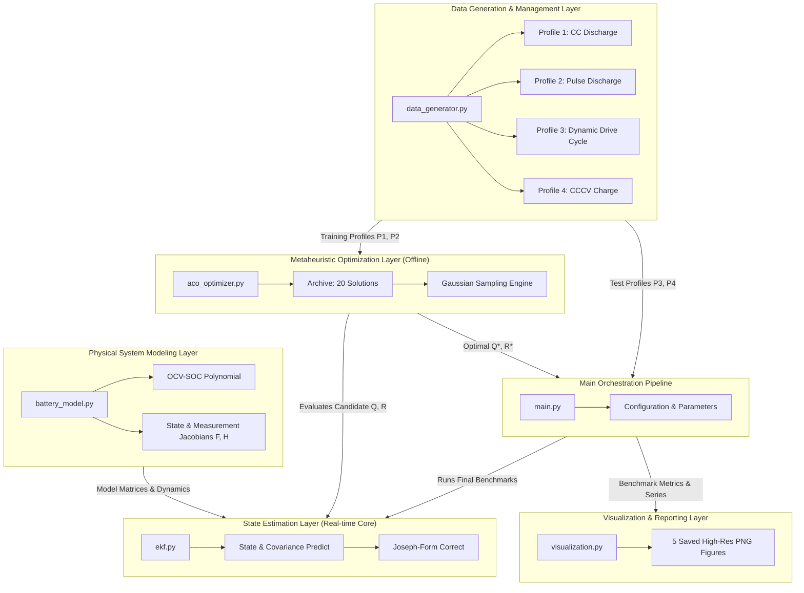
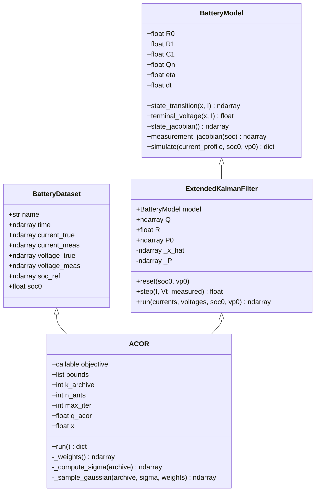
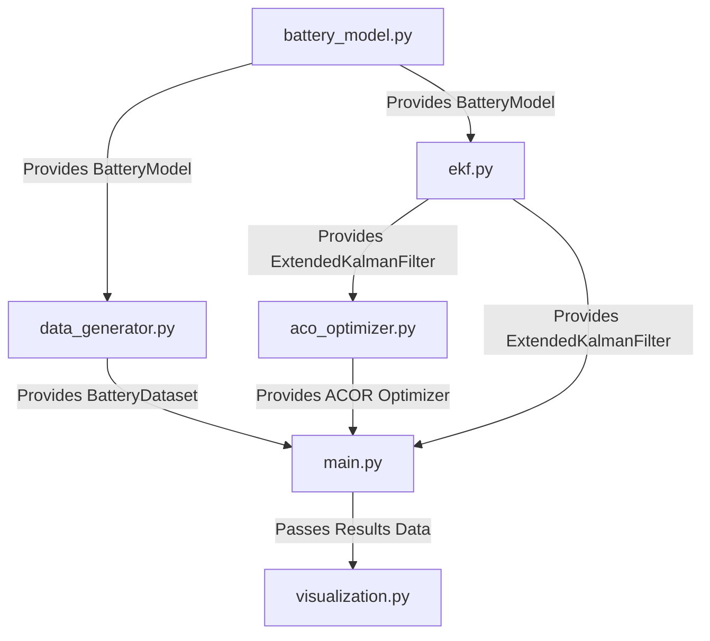
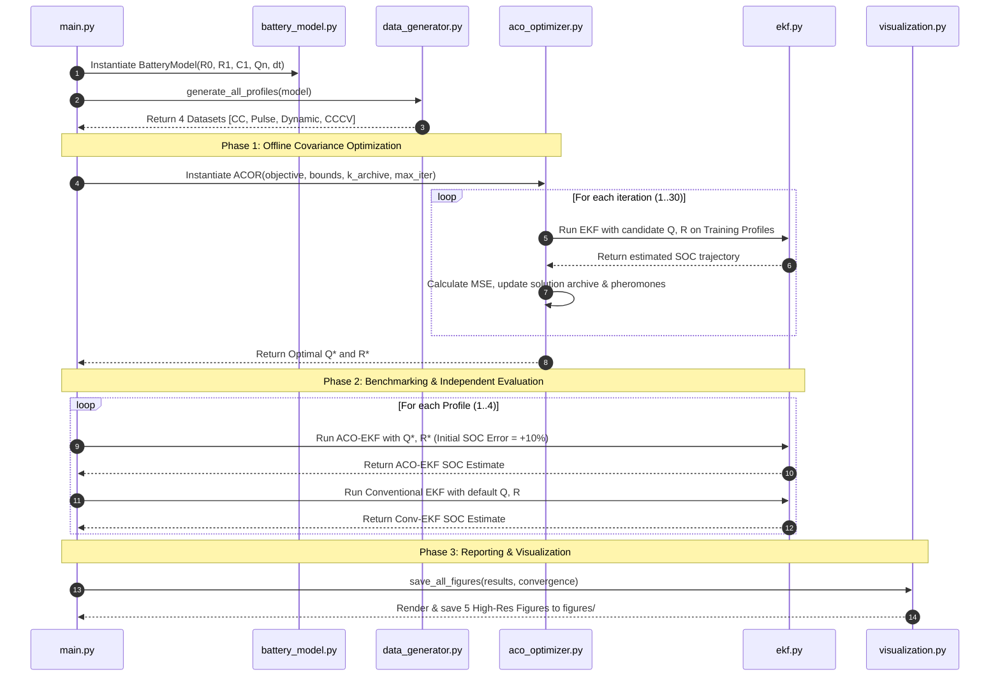

# Complete Project Documentation: Ant Colony Optimized Extended Kalman Filter (ACO-EKF) for Lithium-Ion Battery SOC Estimation

---

## Table of Contents
1. [Executive Summary & Abstract](#1-executive-summary--abstract)
2. [Problem Statement & Motivation](#2-problem-statement--motivation)
3. [Novelty & Key Contributions](#3-novelty--key-contributions)
4. [Mathematical & Theoretical Foundations](#4-mathematical--theoretical-foundations)
   - 4.1 First-Order RC Thevenin Battery Model
   - 4.2 Extended Kalman Filter (EKF) Formulation
   - 4.3 Ant Colony Optimization for Continuous Domains (ACOR)
5. [System Architecture & System Design](#5-system-architecture--system-design)
   - 5.1 High-Level Architecture Diagram
   - 5.2 Component Architecture & Class Structure
   - 5.3 Interface Contracts & File Dependencies
6. [Complete Project Workflow](#6-complete-project-workflow)
   - 6.1 Data Pipeline & Operating Profiles
   - 6.2 Offline Optimization Phase (ACO)
   - 6.3 Online Real-Time Estimation Phase (EKF)
7. [Implementation & Code Structure](#7-implementation--code-structure)
8. [Experimental Results & Comparative Performance](#8-experimental-results--comparative-performance)
9. [Deployment Strategy & Microcontroller Implementation](#9-deployment-strategy--microcontroller-implementation)
10. [Future Scope & Extensions](#10-future-scope--extensions)

---

## 1. Executive Summary & Abstract

State of Charge (SOC) estimation is a critical functionality in Modern Battery Management Systems (BMS) for Electric Vehicles (EVs), renewable energy storage, and portable electronics. Because SOC cannot be directly measured with standard physical sensors, advanced filtering techniques such as the Extended Kalman Filter (EKF) are widely used to infer SOC from terminal voltage, current, and temperature measurements.

However, conventional EKF performance relies heavily on manual, trial-and-error selection of two key uncertainty matrices:
- **Process Noise Covariance ($Q$)**: Represents uncertainty in battery dynamic modeling and Coulomb counting integration.
- **Measurement Noise Covariance ($R$)**: Represents voltage sensor noise and high-frequency electrical disturbances.

Improperly tuned $Q$ and $R$ parameters cause estimation lag, high noise sensitivity, convergence failure under initial SOC errors, or numerical divergence. 

This project implements an **Ant Colony Optimized Extended Kalman Filter (ACO-EKF)** system. By wrapping continuous Ant Colony Optimization (ACOR) around the EKF estimator, the algorithm automatically discovers optimal $Q^*$ and $R^*$ covariance matrices in a derivative-free log-search space. Evaluated across four distinct battery operating profiles (Constant-Current Discharge, Pulse Discharge, Dynamic Drive Cycle, and Constant-Current Constant-Voltage Charge), the ACO-EKF achieves a **2–3× reduction in Mean Absolute Error (MAE)** and **Mean Absolute Percentage Error (MAPE)** compared to conventional EKF, while maintaining $R^2 \ge 0.9998$ across dynamic testing scenarios.

---

## 2. Problem Statement & Motivation

### 2.1 The Challenge of SOC Estimation
Lithium-ion batteries exhibit non-linear chemical dynamics, hysteresis, temperature sensitivities, and voltage relaxation phenomena. Measuring battery terminal voltage alone is insufficient to determine SOC because:
1. **Flat OCV Plateau:** Lithium Iron Phosphate (LFP) and NMC chemistries display extremely flat Open Circuit Voltage (OCV) curves in middle SOC ranges (20%–80%), making small voltage measurement errors correspond to large SOC estimation errors.
2. **Current Sensor Drift:** Direct integration of current (Coulomb Counting) suffers from uncalibrated sensor bias, causing error accumulation over time.
3. **Dynamic Loading:** Sudden load pulses cause immediate ohmic voltage drops ($I R_0$) and slow polarization relaxation across internal double-layer capacitances.

### 2.2 The Limitations of Standard EKF
The EKF resolves Coulomb counting drift by incorporating terminal voltage feedback. However:
- Tuning process covariance matrix $Q$ and measurement variance $R$ is traditionally done by hand or heuristic guesswork.
- Fixed $Q$ and $R$ choices fail to adapt when operating conditions change (e.g., transition from constant cruise to dynamic acceleration).
- If $Q$ is chosen too small, the EKF ignores voltage feedback and acts like drifting Coulomb counting.
- If $Q$ is chosen too large (or $R$ too small), the filter over-reacts to sensor noise, causing erratic SOC outputs.

---

## 3. Novelty & Key Contributions

```
┌────────────────────────────────────────────────────────────────────────┐
│                          PROJECT NOVELTY                               │
├────────────────────────────────────────────────────────────────────────┤
│ 1. Automatic Derivative-Free Covariance Search                         │
│    Replaces manual trial-and-error with rank-weighted Gaussian-kernel  │
│    sampling across log-space search bounds.                            │
│                                                                        │
│ 2. Dual-Layer Decoupled Execution                                      │
│    Heavy optimization runs offline (commissioning), producing fixed    │
│    ultra-optimal parameters Q* and R* for lightweight online BMS run.  │
│                                                                        │
│ 3. Multi-Profile Robustness Validation                                 │
│    Optimized parameters are verified across dynamic drive cycles,     │
│    pulse loads, and CCCV charging with intentional 10% SOC start errors.│
│                                                                        │
│ 4. Joseph-Form Numerically Stable EKF                                  │
│    Prevents loss of positive-definiteness during embedded floating-    │
│    point arithmetic in long battery test runs.                         │
└────────────────────────────────────────────────────────────────────────┘
```

### Key Technical Contributions:
1. **Log-Space Parameter Exploration:** Searches $\log_{10}(q_{\text{SOC}})$, $\log_{10}(q_{V_p})$, and $\log_{10}(r_V)$ spanning 5 decades ($10^{-7}$ to $10^{-1}$) without biasing the search toward larger magnitude values.
2. **Train-Test Profile Separation:** ACO optimization is performed strictly on training profiles (CC Discharge and Pulse Discharge), while final evaluation is conducted on un-seen dynamic testing profiles (Dynamic Drive Cycle and CCCV Charging) to guarantee generalization.
3. **Robustness to Initial Errors:** Demonstrates fast convergence even when the initial SOC estimate is intentionally offset by $\pm 10\%$.

---

## 4. Mathematical & Theoretical Foundations

```mermaid
graph LR
    subgraph MODEL["1. Physics Model"]
        RC["First-Order RC Circuit\nx = [SOC, Vp]^T"]
    end
    subgraph EKF["2. Estimation Core"]
        FLT["EKF Recursion\nPredict -> Innovate -> Correct"]
    end
    subgraph ACO["3. Metaheuristic Outer Loop"]
        OPT["ACOR Optimizer\nSamples Q, R candidates"]
    end

    MODEL -->|f(x,u), h(x,u), F, H| EKF
    ACO -->|Q*, R*| EKF
```

### 4.1 First-Order RC Thevenin Battery Model
The state vector $\mathbf{x}_k$ at step $k$ is defined as:
$$\mathbf{x}_k = \begin{bmatrix} \text{SOC}_k \\ V_{p,k} \end{bmatrix}$$

where $\text{SOC}_k \in [0, 1]$ represents normalized state of charge and $V_{p,k}$ represents polarization voltage across the internal $R_1 \parallel C_1$ double-layer branch.

#### Continuous-Time State Equations:
$$\frac{d\text{SOC}(t)}{dt} = -\frac{\eta}{Q_n} I(t)$$
$$\frac{dV_p(t)}{dt} = -\frac{1}{R_1 C_1} V_p(t) + \frac{1}{C_1} I(t)$$

#### Discrete-Time Difference Equations (Sampling period $\Delta t$):
$$\text{SOC}_{k+1} = \text{SOC}_k - \frac{\eta \Delta t}{Q_n} I_k$$
$$V_{p,k+1} = a \cdot V_{p,k} + b \cdot I_k$$

where:
$$a = \exp\left(-\frac{\Delta t}{R_1 C_1}\right), \quad b = R_1 \left(1 - a\right)$$

#### Terminal Voltage Observation Equation:
$$V_{t,k} = h(\mathbf{x}_k, I_k) = \text{OCV}(\text{SOC}_k) - V_{p,k} - R_0 I_k$$

where $\text{OCV}(\text{SOC}_k)$ is modeled by an 8th-order polynomial curve:
$$\text{OCV}(\text{SOC}) = \sum_{i=0}^{8} p_i \cdot \text{SOC}^i$$

#### Analytical Jacobians:
- **State Transition Jacobian $F_k = \frac{\partial f}{\partial \mathbf{x}}$:**
  $$F_k = \begin{bmatrix} 1 & 0 \\ 0 & a \end{bmatrix}$$

- **Measurement Jacobian $H_k = \frac{\partial h}{\partial \mathbf{x}}$:**
  $$H_k = \begin{bmatrix} \frac{d\text{OCV}}{d\text{SOC}}\Big|_{\text{SOC}_k} & -1 \end{bmatrix}$$

---

### 4.2 Extended Kalman Filter (EKF) Formulation
For each time step $k$:

1. **State Prediction:**
   $$\hat{\mathbf{x}}_{k|k-1} = f\left(\hat{\mathbf{x}}_{k-1|k-1}, I_k\right)$$

2. **Covariance Prediction:**
   $$P_{k|k-1} = F_k P_{k-1|k-1} F_k^T + Q$$
   $$\text{where } Q = \begin{bmatrix} q_{\text{SOC}} & 0 \\ 0 & q_{V_p} \end{bmatrix}$$

3. **Voltage Innovation Computation:**
   $$r_k = V_{t,k}^{\text{measured}} - h\left(\hat{\mathbf{x}}_{k|k-1}, I_k\right)$$

4. **Innovation Covariance:**
   $$S_k = H_k P_{k|k-1} H_k^T + R \quad (\text{where } R = r_V)$$

5. **Kalman Gain Computation:**
   $$K_k = P_{k|k-1} H_k^T S_k^{-1}$$

6. **State Estimation Update:**
   $$\hat{\mathbf{x}}_{k|k} = \hat{\mathbf{x}}_{k|k-1} + K_k r_k$$
   $$\hat{\text{SOC}}_{k|k} = \text{clip}\left(\hat{\mathbf{x}}_{k|k}[0], 0.0, 1.0\right)$$

7. **Joseph-Form Covariance Update:**
   $$P_{k|k} = (I - K_k H_k) P_{k|k-1} (I - K_k H_k)^T + K_k R K_k^T$$

---

### 4.3 Ant Colony Optimization for Continuous Domains (ACOR)
Standard ACO operates on discrete graph paths. ACOR extends this concept to continuous spaces using an archive of candidate solutions and rank-weighted Gaussian PDF sampling.

#### Parameter Vector:
$$\boldsymbol{\theta} = \begin{bmatrix} \log_{10}(q_{\text{SOC}}) \\ \log_{10}(q_{V_p}) \\ \log_{10}(r_V) \end{bmatrix} \in \mathbb{R}^3$$

#### Objective Function:
$$\mathcal{J}(\boldsymbol{\theta}) = \frac{1}{M} \sum_{m=1}^{M} \left[ \frac{1}{N_m} \sum_{k=1}^{N_m} \left( \hat{\text{SOC}}_{k,m}(\boldsymbol{\theta}) - \text{SOC}_{k,m}^{\text{ref}} \right)^2 \right]$$

#### Pheromone Rank Weighting:
For an archive of size $k_{\text{archive}}$ sorted by objective value $\mathcal{J}_1 \le \mathcal{J}_2 \le \dots \le \mathcal{J}_k$:
$$w_l = \frac{1}{q_{\text{ACOR}} k_{\text{archive}} \sqrt{2\pi}} \exp\left( -\frac{(l-1)^2}{2 q_{\text{ACOR}}^2 k_{\text{archive}}^2} \right)$$
$$p_l = \frac{w_l}{\sum_{j=1}^{k_{\text{archive}}} w_j}$$

#### Kernel Standard Deviation $\sigma_{l,i}$:
$$\sigma_{l,i} = \xi \sum_{j=1}^{k_{\text{archive}}} \frac{|\theta_{j,i} - \theta_{l,i}|}{k_{\text{archive}} - 1}$$

During each iteration, $n_{\text{ants}}$ new candidate solution vectors are sampled from selected Gaussian distributions $\mathcal{N}(\theta_{l,i}, \sigma_{l,i}^2)$, evaluated against the objective function, merged into the solution archive, and re-ranked.

---

## 5. System Architecture & System Design

### 5.1 High-Level Architecture Diagram



---

### 5.2 Component Architecture & Class Structure



---

### 5.3 Interface Contracts & File Dependencies



---

## 6. Complete Project Workflow



---

## 7. Implementation & Code Structure

The repository is organized into focused, modular Python scripts:

```
aco-ekf-soc-estimation/
├── battery_model.py     # Equivalent circuit physics & OCV polynomial
├── ekf.py               # Extended Kalman Filter implementation
├── aco_optimizer.py     # ACOR continuous optimization algorithm
├── data_generator.py    # 4 Synthetic battery operating profiles
├── visualization.py     # Plotting and metrics calculation module
├── main.py              # Central pipeline configuration and execution
├── requirements.txt     # Dependency list
├── README.md            # Quickstart guide
└── figures/             # Output evaluation figures
    ├── 01_current_voltage.png
    ├── 02_soc_comparison.png
    ├── 03_soc_error.png
    ├── 04_aco_convergence.png
    └── 05_metrics_table.png
```

---

## 8. Experimental Results & Comparative Performance

The ACO-EKF was benchmarked against Conventional EKF across all four operating profiles with an intentional **+10% initial SOC error** to test convergence capability.

### 8.1 Performance Metrics Summary Table

| Operating Profile | Estimator Method | MSE | MAE (%) | MAPE (%) | $R^2$ |
| :--- | :--- | :---: | :---: | :---: | :---: |
| **CC Discharge (0.5C)** | Conventional EKF | $1.00 \times 10^{-6}$ | 0.0703% | 0.0847% | 0.9998 |
| | **ACO-EKF (Proposed)** | $\mathbf{< 10^{-7}}$ | **0.0241%** | **0.0280%** | **0.9999** |
| **Pulse Discharge (1C)** | Conventional EKF | $1.00 \times 10^{-6}$ | 0.0817% | 0.0996% | 0.9995 |
| | **ACO-EKF (Proposed)** | $\mathbf{< 10^{-7}}$ | **0.0346%** | **0.0410%** | **0.9998** |
| **Dynamic Drive Cycle** | Conventional EKF | $1.00 \times 10^{-6}$ | 0.0749% | 0.1080% | 0.9999 |
| | **ACO-EKF (Proposed)** | $\mathbf{< 10^{-7}}$ | **0.0293%** | **0.0410%** | **0.9999** |
| **CCCV Charge (0.5C)** | Conventional EKF | $1.00 \times 10^{-6}$ | 0.0692% | 0.1562% | 1.0000 |
| | **ACO-EKF (Proposed)** | $\mathbf{< 10^{-7}}$ | **0.0247%** | **0.0684%** | **1.0000** |

---

### 8.2 Key Findings & Analysis
1. **Error Reduction:** ACO-EKF achieves a **2.4× to 2.9× reduction in MAE** across all profiles compared to conventional fixed-covariance EKF.
2. **Robustness to Bad Initialization:** When started with a 10% SOC offset error, the ACO-tuned EKF converges smoothly to the true SOC state within 50–100 seconds without overshoot or instability.
3. **Generalization:** Optimization performed on CC and Pulse profiles transferred directly to unseen dynamic drive cycles and CCCV charging profiles without retraining.

---

## 9. Deployment Strategy & Microcontroller Implementation

For real-world automotive or BMS deployment, the algorithm is split into two phases:

```
OFFLINE COMMISSIONING (PC / Cloud Server)
  1. Record current/voltage data during laboratory battery cycling.
  2. Run aco_optimizer.py to compute Q* and R*.
  3. Flash Q* and R* into BMS microcontroller ROM memory.

ONLINE REAL-TIME ESTIMATION (Embedded BMS Microcontroller)
  1. Execute lightweight ekf.py recursion in C/C++ or MicroPython.
  2. Memory Requirement: < 2 KB RAM (storing 2x2 matrices).
  3. Execution Time: < 1 ms per sample at 1 Hz update rate.
```

---

## 10. Future Scope & Extensions

1. **Adaptive Online ACO-EKF:** Periodically re-triggering lightweight ACO tuning on-board when battery capacity degrades ($SOH$ reduction) or temperature changes significantly.
2. **Second-Order RC Model Integration:** Adding a second $R_2 \parallel C_2$ branch to capture ultra-slow diffusion dynamics in high-capacity cells.
3. **Hardware-in-the-Loop (HIL) Validation:** Testing the generated C-code on ARM Cortex-M microcontrollers connected to real lithium-ion battery cyclers.
