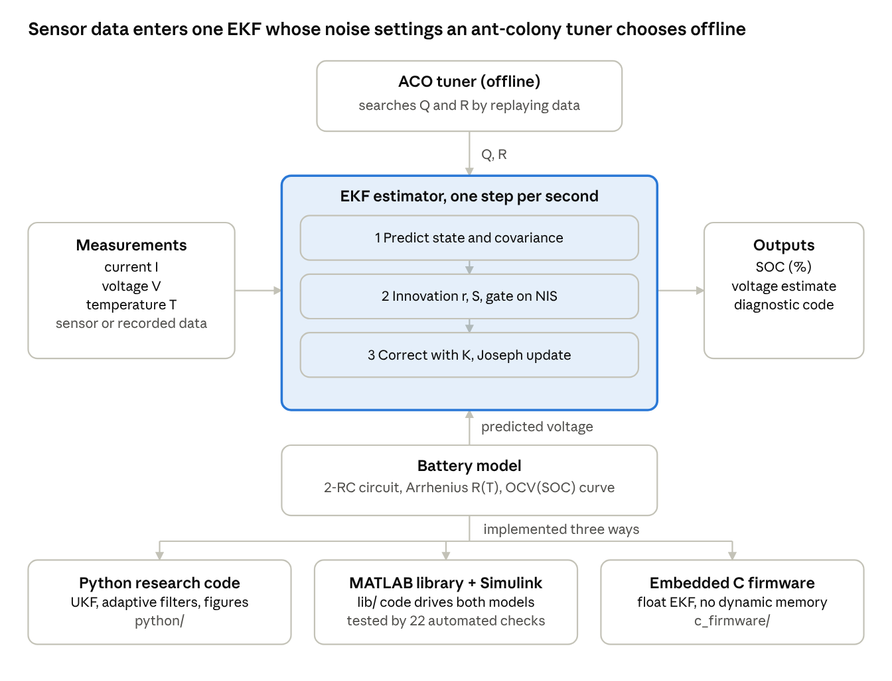
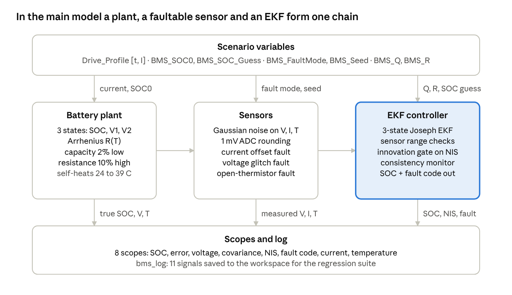
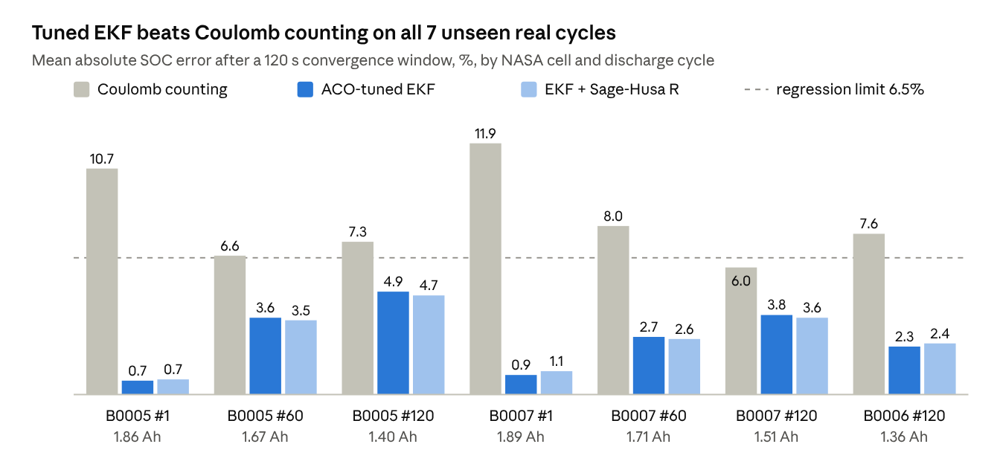
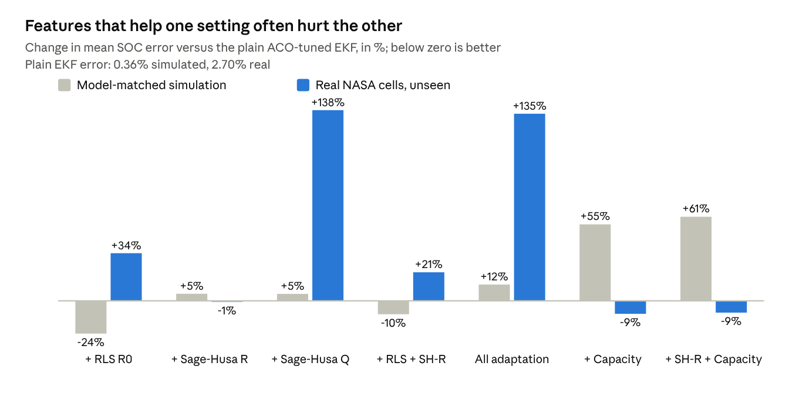

# ACO-EKF Battery SOC Estimation — Complete Technical Guide

*Last updated 9 October 2026. Describes the code in `python/`, `simulink_matlab/` and `c_firmware/`.*

## 1. Project overview

This project estimates how full a lithium-ion battery is, its State of Charge (SOC), in real time from voltage, current and temperature. On real fresh cells it holds the error near 1%, where plain current integration drifts by about 11%.

**The problem.** A battery has no fuel gauge. SOC is an internal quantity, so a Battery Management System (BMS) must infer it from three noisy measurements: terminal voltage, current and temperature. A wrong SOC means a car that strands its driver, or a pack that is over-charged and unsafe.

**The idea in one paragraph.** A mathematical model of the cell predicts what the terminal voltage should be. The estimator compares that prediction with the measured voltage and uses the difference to correct its SOC guess. The correction is weighted by how much it trusts the model versus the sensor. That weighting is the job of a Kalman filter. Its trust settings, the noise covariances Q and R, are tuned automatically by an Ant Colony Optimisation (ACO) algorithm instead of by hand.

**Three implementations of the same algorithm**

| Implementation | Folder | Purpose |
| --- | --- | --- |
| Python | `python/` | Research pipeline: EKF, UKF, ACO, adaptive filters, a residual neural network, benchmarks, figures |
| Embedded C firmware | `c_firmware/` | The 3-state Joseph-form EKF with diagnostics and no dynamic memory, for a 32-bit BMS microcontroller |
| MATLAB / Simulink | `simulink_matlab/` | Model-based design: block-diagram models, fault injection, an automated 33-check regression suite |

**Results at a glance.** Errors are mean absolute SOC error after a 120 s convergence window. Details and caveats are in section 16.

| Test | ACO-tuned EKF | Coulomb counting |
| --- | --- | --- |
| 40 randomised simulated runs | 0.48% | 10.7% |
| Real fresh cells, unseen (NASA B0005 and B0007, cycle 1) | 0.66% and 0.93% | 10.7% and 11.9% |
| Real aged cells, unseen (capacity 1.36 to 1.67 Ah) | 2.3% to 4.9% | 6.0% to 8.0% |
| Real fresh charge cycles (B0005, B0007) | 3.6% and 3.7% | 6.7% and 7.3% |

**How to read this guide.** Sections 3 to 11 teach the theory and the mathematics behind each block. Sections 12 to 15 show how the theory is built in Simulink, C and Python and which data feeds it. Section 16 reports the evidence, and section 17 explains how to run everything.

## 2. System architecture

One estimator sits at the centre. Every second it takes current, voltage and temperature, predicts the cell's voltage with a model, and corrects its SOC from the prediction error. An ant-colony tuner sets the filter's noise levels offline.



Read the diagram top to bottom. The tuner replays recorded data many times with different Q and R and hands the best pair to the estimator. The battery model supplies the voltage prediction. The same algorithm exists in Python, in the MATLAB and Simulink library, and in C.

**The online loop, once per second**

1. The sensors deliver current I, voltage V and temperature T.
2. The model advances the three states (SOC, V1, V2) and predicts the terminal voltage.
3. The estimator compares the prediction with the measured voltage. If the difference is plausible, it corrects the states; if not, it skips the correction.
4. The result leaves as SOC in percent, the voltage estimate, and a diagnostic code.

**The offline loop, run when the cell or data changes**

1. The ACO tuner picks candidate values of Q and R.
2. For each candidate it runs the whole filter over training data and scores the error.
3. The best Q and R are stored (in `lib/bms_tuned_data.m` for the MATLAB side) and the models read them from there.

**Folder map**

| Folder | Contents |
| --- | --- |
| `python/` | Research pipeline: EKF, UKF, ACO, adaptive filters, neural network, benchmarks |
| `simulink_matlab/` | The two Simulink models, the shared algorithm library `lib/`, run scripts and the regression suite |
| `c_firmware/` | The embedded C implementation of the baseline EKF |
| `data/` and `data_raw/` | Processed CSV files, and the official NASA `.mat` files |
| `figures/` | Publication figures 00 to 16 |
| `docs/` | Technical documents, presentation and references |
| `tools/` and `models/` | Diagram-drawing scripts, and generated neural-network weights |
| `archive/` | Files not needed to build or run the project |

**The most important files**

| File | Why it matters |
| --- | --- |
| `simulink_matlab/advanced_bms_aco_ekf.slx` | The main Simulink model |
| `simulink_matlab/sota_bms_aco_ekf.slx` | The Simulink model that replays real NASA cells |
| `simulink_matlab/lib/bms_est_step.m` | The estimator itself: EKF, diagnostics and all adaptive extensions |
| `simulink_matlab/lib/bms_params.m` | Every parameter in one place |
| `simulink_matlab/run_bms_regression.m` | The automated verification suite |
| `python/main.py` | The Python research pipeline |
| `c_firmware/bms_ekf.c` | The embedded implementation |

## 3. Battery fundamentals

SOC is the fraction of a cell's usable charge that is still stored in it, from 0 (empty) to 1 (full). It cannot be read off a sensor, so every method below estimates it indirectly.

**Definition.** If Q\_n is the cell's capacity in ampere-seconds, I is the current (positive when discharging) and eta is the coulombic efficiency (1 here), SOC at time t is:

$$
\mathrm{SOC}(t) = \mathrm{SOC}(t_0) - \frac{1}{Q_n}\int_{t_0}^{t} \eta\, I(\tau)\, d\tau
$$

For the 2.0 Ah nominal cell used throughout, Q\_n = 2.0 x 3600 = 7200 As. Discharging at 2 A therefore empties the cell in 3600 s.

**Open-circuit voltage (OCV).** After a cell rests for a while with no current, its terminal voltage settles to a value that depends only on SOC. That value is the OCV, and the curve OCV(SOC) is increasing: about 3.0 V empty and 4.1 to 4.2 V full for the NASA cells. The OCV curve is the bridge between the measurable voltage and the hidden SOC.

The curve is steep near the ends and flat in the middle. Where it is flat, a large SOC change produces a small voltage change, so voltage says little about SOC there. This is why the filter's gain depends on the slope dOCV/dSOC, which appears in the measurement Jacobian in section 6.

**Under load the voltage is not the OCV.** When current flows the terminal voltage drops below the OCV by an instant ohmic drop (R0 x I) and by slower polarisation voltages that build up and relax over seconds to minutes. Reading SOC straight from the terminal voltage would be wrong by several percent. The battery model in section 4 captures exactly these effects so they can be subtracted.

**Why the simple methods are not enough**

| Method | How it works | Weakness |
| --- | --- | --- |
| Coulomb counting | Integrate the current from a known start | Never forgets a wrong start; sensor offset and capacity fade add up. In our tests, a 15% wrong start stays a roughly 10% error |
| OCV look-up | Rest the cell, read the voltage, invert the curve | Needs minutes to hours of rest; useless while driving; the flat middle of the curve is imprecise |
| Model-based observer (this project) | Predict voltage with a model, correct the SOC from the voltage error | Needs a decent model and well-chosen noise settings (the ACO's job) |

The observer combines the strengths of the first two: it integrates current for short-term accuracy (Coulomb counting) and uses voltage to pull the estimate back to the truth over time (the OCV relation). The Kalman filter decides how much to trust each at every second.

## 4. The battery model

The estimator needs a model that turns a current history into a predicted terminal voltage. We use a second-order resistor-capacitor (2-RC) equivalent circuit whose resistances change with temperature. The circuit is an open-circuit voltage source OCV(SOC) in series with a resistor R0 and two parallel RC pairs, R1 with C1 and R2 with C2. The terminal voltage Vt is what is left after those drops.

**States and their meaning**

| State | Symbol | Meaning |
| --- | --- | --- |
| State of charge | SOC | Stored charge as a fraction, 0 to 1 |
| Fast polarisation voltage | V1 | Voltage across R1 and C1: charge-transfer effects, time constant tau1 = R1 x C1 |
| Slow polarisation voltage | V2 | Voltage across R2 and C2: diffusion effects, time constant tau2 = R2 x C2 |

The input is the current I, positive when discharging. The output is the terminal voltage Vt.

**Continuous-time equations.** Kirchhoff's current law on each RC pair says the current I splits between the capacitor and the resistor, which gives a first-order differential equation per pair. SOC is the integral of current from section 3.

$$
\frac{d\,\mathrm{SOC}}{dt} = -\frac{\eta I}{Q_n}, \qquad
\frac{dV_1}{dt} = -\frac{V_1}{R_1 C_1} + \frac{I}{C_1}, \qquad
\frac{dV_2}{dt} = -\frac{V_2}{R_2 C_2} + \frac{I}{C_2}
$$

**Exact discretisation (derivation).** The BMS samples every dt = 1 s and the current is nearly constant during one step (zero-order hold). Take the first RC pair with time constant tau = R1 C1. Multiply the equation by the integrating factor e^(t/tau):

$$
\frac{d}{dt}\left(V_1 e^{t/\tau}\right) = \frac{I}{C_1} e^{t/\tau}
$$

Integrate from t\_k to t\_k + dt with I constant:

$$
V_1(k+1)\, e^{(t_k+\Delta t)/\tau} - V_1(k)\, e^{t_k/\tau} = \frac{I\,\tau}{C_1}\left(e^{(t_k+\Delta t)/\tau} - e^{t_k/\tau}\right)
$$

Divide by e^((t\_k + dt)/tau) and use tau / C1 = R1:

$$
V_1(k+1) = a_1 V_1(k) + b_1 I(k), \qquad a_1 = e^{-\Delta t/(R_1 C_1)}, \qquad b_1 = R_1\,(1 - a_1)
$$

The second pair is identical with a2 = exp(-dt / (R2 C2)) and b2 = R2 (1 - a2). Because this is the exact solution, not an Euler approximation, it stays accurate even when dt is comparable to tau. The coefficient a is always between 0 and 1: it is the fraction of the polarisation voltage that survives one step. The coefficient b is the steady-state gain per step.

**Measurement (output) equation.** The terminal voltage is the open-circuit voltage minus the three drops:

$$
V_t(k) = \mathrm{OCV}\big(\mathrm{SOC}(k)\big) - V_1(k) - V_2(k) - R_0\, I(k)
$$

This is the only nonlinear part of the model, because OCV is a curve. The state update is linear.

**State-space form.** With x = \[SOC, V1, V2\] transposed and sample index k:

$$
x_{k+1} = F x_k + B I_k, \qquad
F = \begin{bmatrix} 1 & 0 & 0 \\ 0 & a_1 & 0 \\ 0 & 0 & a_2 \end{bmatrix}, \qquad
B = \begin{bmatrix} -\eta\,\Delta t / Q_n \\ b_1 \\ b_2 \end{bmatrix}
$$

**Indexing convention in the code.** At sample k the current I(k) is applied to the state first, and the same I(k) then appears in the voltage equation. So V1 and V2 at sample k already include the effect of I(k). The equations above are written in this one-step form because the plant, the estimator and the firmware all follow it, and it is also the form that the identification in section 9.3 assumes.

**Temperature dependence (Arrhenius law).** Chemical reaction rates slow down in the cold, so the resistances rise. We scale R0, R1 and R2 from their 25 C reference values with the Arrhenius equation, where Ea = 18000 J/mol is the activation energy, Rg = 8.314 J/(mol K) is the gas constant and T is in kelvin:

$$
R(T) = R_{\mathrm{ref}} \exp\!\left[\frac{E_a}{R_g}\left(\frac{1}{T} - \frac{1}{T_{\mathrm{ref}}}\right)\right], \qquad T_{\mathrm{ref}} = 298.15\ \mathrm{K}
$$

At 40 C (313.15 K) the factor is 0.71, so resistances drop by about 29%. At 0 C (273.15 K) it is 1.94, so they nearly double. Because a1 and a2 depend on R, they change with temperature too, which is why the matrix F is recomputed every step.

**Parameters used**

| Parameter | Simulated cell | NASA-calibrated cell |
| --- | --- | --- |
| R0 at 25 C | 0.012 ohm | 0.060 ohm |
| R1, C1, tau1 | 0.008 ohm, 1500 F, 12 s | 0.030 ohm, 1500 F, 45 s |
| R2, C2, tau2 | 0.015 ohm, 12000 F, 180 s | 0.020 ohm, 10000 F, 200 s |
| Capacity Qn | 7200 As (2.0 Ah) | 7200 As (2.0 Ah) |
| OCV curve | 8th-order polynomial from the base paper | 8th-order polynomial fitted on real cell B0006 |

**OCV polynomials.** The simulated cell uses the base paper's 8th-order polynomial in SOC, with coefficients -21.7497, 82.2625, -125.3296, 99.6313, -44.5010, 11.3416, -1.5825, 1.5032 and 3.0130 from the SOC^8 term down to the constant. It is smooth but reaches 4.59 V at full charge, above the 4.2 V limit of a real cell. The simulation is internally consistent, so this does not break it, but the curve is not physical. The NASA variant replaces it with a curve fitted to real data (section 15), which spans 2.97 V to 4.12 V.

**Plant versus estimator.** The simulator that generates the "true" cell deliberately differs from the model inside the filter: its capacity is 2% lower and its resistances 10% higher. If the two were identical, the filter would be graded on its own model and look better than it should.

## 5. Kalman filter theory

A Kalman filter is a recursive estimator that, at every step, blends a model's prediction with a noisy measurement in exactly the proportion that minimises the expected squared error. This section derives it from scratch for a linear system. Section 6 extends it to our nonlinear battery.

**The setting.** A hidden state x evolves linearly with random disturbances, and we observe it through a noisy measurement z:

$$
x_{k+1} = F x_k + B u_k + w_k, \quad w_k \sim \mathcal{N}(0, Q)
\qquad\qquad
z_k = H x_k + v_k, \quad v_k \sim \mathcal{N}(0, R)
$$

Here Q is the process-noise covariance (how wrong the model is allowed to be per step) and R is the measurement-noise covariance (how noisy the sensor is). The noises are zero-mean, white and independent of each other. We write x\_minus for the prediction before seeing z\_k and x\_plus for the estimate after, with error covariances P\_minus and P\_plus.

**Step 1: Predict (time update).** Push the previous estimate through the model:

$$
\hat{x}^-_k = F \hat{x}^+_{k-1} + B u_{k-1}
$$

The prediction error is e\_minus = x - x\_minus = F e\_plus(k-1) + w(k-1). The old error and the new disturbance are independent, so their covariances add:

$$
P^-_k = F P^+_{k-1} F^{T} + Q
$$

Uncertainty grows by Q at every prediction. Without measurements, the filter would become steadily less sure.

**Step 2: Correct (measurement update).** We look for a linear correction proportional to the innovation r, the difference between what we measured and what we predicted we would measure:

$$
r_k = z_k - H \hat{x}^-_k, \qquad \hat{x}^+_k = \hat{x}^-_k + K_k\, r_k
$$

The matrix K is the Kalman gain, still to be chosen. Substitute z = Hx + v and subtract from x to get the posterior error:

$$
e^+_k = (I - K H)\, e^-_k - K v_k
$$

The prior error and the sensor noise are independent, so the posterior covariance is, for any gain K:

$$
P^+_k = (I - K H)\, P^-_k\, (I - K H)^{T} + K R K^{T}
\qquad \text{(Joseph form)}
$$

**Step 3: The optimal gain (derivation).** Choose K to minimise the total expected squared error, which is the trace of P\_plus. Expand the Joseph form:

$$
\mathrm{tr}(P^+) = \mathrm{tr}(P^-) - 2\,\mathrm{tr}(K H P^-) + \mathrm{tr}\!\big(K (H P^- H^{T} + R) K^{T}\big)
$$

Define the innovation covariance S = H P\_minus H^T + R. Set the derivative with respect to K to zero:

$$
\frac{\partial\, \mathrm{tr}(P^+)}{\partial K} = -2 P^- H^{T} + 2 K S = 0
\;\;\Longrightarrow\;\;
\boxed{K = P^- H^{T} S^{-1}}
$$

Substituting K S = P\_minus H^T back into the Joseph form collapses it to the short expression P\_plus = (I - K H) P\_minus.

**Reading the gain.** For a single state and sensor the gain is K = P H / (H squared x P + R). When the sensor is very noisy (R large), K is near 0 and the filter ignores the measurement. When the model is very uncertain (P large) or the sensor very clean (R small), K approaches 1 / H and the filter trusts the measurement. The Kalman filter therefore automatically trades model trust against sensor trust, using the covariances as the exchange rate.

**Why we use the Joseph form in code.** The short form (I - K H) P\_minus subtracts nearly equal matrices. In finite precision, especially in 32-bit floats on a microcontroller, rounding can make P lose symmetry or turn slightly negative, after which the filter can diverge. The Joseph form is a sum of two positive semi-definite terms, so it stays valid. It is also correct for any gain, which matters when a measurement is rejected or the state is clamped. Every estimator in this project uses it.

**Innovation as a health signal.** If the model and the noise settings are right, the innovation r is zero-mean and white with covariance S. The normalised innovation squared, NIS = r squared / S for a single measurement, is then chi-square distributed with 1 degree of freedom and averages 1. A long-run NIS far below 1 means the filter is too pessimistic, and far above 1 means it is too confident or the model is wrong. Section 10 uses this for diagnostics.

**Optimality.** For a linear system with Gaussian noise the Kalman filter is the minimum mean-square-error estimator. For other noise distributions it is the best linear unbiased estimator. Our battery is not linear, so it will only be approximately optimal, which is the subject of the next section.

## 6. The Extended Kalman Filter (EKF)

The Extended Kalman Filter is the Kalman filter applied to a nonlinear measurement by replacing the curve with its straight-line approximation at every step. Our battery needs this because the terminal voltage depends on SOC through the curved OCV function.

**Linearisation.** The measurement is z = h(x). Expand h in a first-order Taylor series around the predicted state x\_minus:

$$
h(x) \approx h(\hat{x}^-) + H\,(x - \hat{x}^-), \qquad H = \left.\frac{\partial h}{\partial x}\right|_{x = \hat{x}^-}
$$

The matrix H is the measurement Jacobian. The key point: the EKF still uses the full nonlinear h to compute the predicted voltage and the innovation. The linear H is used only to propagate covariances and to compute the gain.

**Our Jacobians (derivation).** The terminal voltage is Vt = OCV(SOC) - V1 - V2 - R0 I. Take partial derivatives with respect to each state:

$$
H = \begin{bmatrix} \dfrac{\partial V_t}{\partial \mathrm{SOC}} & \dfrac{\partial V_t}{\partial V_1} & \dfrac{\partial V_t}{\partial V_2} \end{bmatrix}
= \begin{bmatrix} \dfrac{d\,\mathrm{OCV}}{d\,\mathrm{SOC}} & -1 & -1 \end{bmatrix}
$$

The slope dOCV/dSOC is the derivative of the OCV polynomial, evaluated analytically with polyder. The code floors it at 0.02 V per unit SOC so that the gain never collapses to zero on a flat part of the curve. The state equation is already linear in the states, so its Jacobian is simply F = diag(1, a1, a2), recomputed each step because a1 and a2 follow the temperature.

**The algorithm, one step per second.** This is exactly what `bms_est_step.m` and the C firmware do.

1. **Read** current I, voltage V and temperature T, and check they are plausible (section 10).
2. **Predict** the state and its covariance:

$$
\mathrm{SOC}^- = \mathrm{clip}\!\left(\mathrm{SOC} - \frac{\eta I \Delta t}{Q_n},\,0,\,1\right),\quad
V_1^- = a_1 V_1 + b_1 I,\quad V_2^- = a_2 V_2 + b_2 I,\quad
P^- = F P F^{T} + Q
$$

3. **Predict the voltage and form the innovation** using the full nonlinear model:

$$
\hat{V} = \mathrm{OCV}(\mathrm{SOC}^-) - V_1^- - V_2^- - R_0 I, \qquad
r = V_{\mathrm{meas}} - \hat{V}, \qquad
S = H P^- H^{T} + R
$$

4. **Gate** the measurement: if r squared / S is implausibly large, skip the correction (section 10).
5. **Correct** with the Kalman gain and the Joseph covariance update:

$$
K = \frac{P^- H^{T}}{S}, \qquad \hat{x}^+ = \hat{x}^- + K r, \qquad
P^+ = (I - KH)\,P^-\,(I - KH)^{T} + K R K^{T}
$$

6. **Output** SOC as 100 times the first state, clipped to the 0 to 100% range. Then repeat for the next sample.

**Why three states.** SOC is the quantity we want. V1 and V2 are included so that the filter can subtract the polarisation voltages from the measurement. If they were left out, the slow voltage relaxation after a load change would be misread as a change in SOC.

**Initialisation.** The state starts at the guessed SOC with V1 = V2 = 0. The initial covariance P0 expresses how sure we are about that guess. It is diag(0.01, 0.0025, 0.0025) for the simulated cell, meaning a SOC standard deviation of 0.1 (10%). It is diag(0.0225, 0.0025, 0.0025) for the NASA cells, a 15% standard deviation. Starting 10% to 20% away from the truth is the normal test: the filter must pull itself in using voltage. The first 120 s of each run are excluded from the error metrics as the convergence window.

**What Q and R mean, and how they trade off.** R is the variance of the voltage error, so sigma = sqrt(R). The tuned values are around 1e-3, which is about 30 mV, larger than the 8 mV sensor noise because it also has to absorb model error. Q is the per-step variance added to each state, a measure of how far the model may drift from reality.

| If you raise... | The filter becomes... | Cost |
| --- | --- | --- |
| R (distrust the voltage) | Smoother and slower to correct | Tracks real changes late |
| Q (distrust the model) | Faster to correct | Noisier, follows sensor errors |

Choosing these by hand is slow and subjective. That is the job given to the ACO in section 8.

**Known limits of the EKF.** The straight-line approximation is poor where the OCV curve bends sharply, notably at the end of discharge, where our error curves show a small spike. The EKF also assumes Gaussian noise. The Unscented Kalman Filter in the next section avoids the linearisation.

## 7. The Unscented Kalman Filter (UKF)

The Unscented Kalman Filter avoids linearising the model. Instead it pushes a small, carefully chosen set of sample points through the true nonlinear equations and rebuilds the mean and covariance from the results. It lives in `python/ukf.py` as a benchmark against the EKF.

**The unscented transform (idea).** Approximating a probability distribution is easier than approximating a nonlinear function. For a state with n entries (here n = 3) we choose 2n + 1 = 7 sigma points that have exactly the current mean and covariance, propagate each through the nonlinear function, and recombine them with weights.

**Sigma points and weights.** With the current estimate x and covariance P, and a scaling parameter lambda:

$$
\chi_0 = \hat{x}, \qquad
\chi_i = \hat{x} + \Big[\sqrt{(n+\lambda)P}\Big]_i, \qquad
\chi_{i+n} = \hat{x} - \Big[\sqrt{(n+\lambda)P}\Big]_i, \quad i = 1,\dots,n
$$

$$
\lambda = \alpha^2 (n+\kappa) - n, \qquad
w^m_0 = \frac{\lambda}{n+\lambda}, \qquad
w^c_0 = w^m_0 + (1 - \alpha^2 + \beta), \qquad
w^m_i = w^c_i = \frac{1}{2(n+\lambda)}
$$

The bracket is column i of the matrix square root of (n + lambda) P, computed by Cholesky factorisation. These choices reproduce the mean exactly and the covariance exactly: the 2n symmetric points each carry weight 1 / (2(n + lambda)), and their outer products sum to (n + lambda) P / (n + lambda) = P.

**One UKF step (as coded)**

1. Generate the 7 sigma points from the current x and P.
2. Propagate each through the state equation to get predicted points, then the predicted mean and covariance:

$$
\hat{x}^- = \sum_i w^m_i\, \chi^-_i, \qquad
P^- = Q + \sum_i w^c_i\, (\chi^-_i - \hat{x}^-)(\chi^-_i - \hat{x}^-)^{T}
$$

3. Pass each predicted point through the voltage equation to get Z\_i, then the predicted voltage, its covariance and the cross-covariance with the state:

$$
\hat{z} = \sum_i w^m_i Z_i, \qquad
S = R + \sum_i w^c_i (Z_i - \hat{z})^2, \qquad
P_{xz} = \sum_i w^c_i\, (\chi^-_i - \hat{x}^-)(Z_i - \hat{z})
$$

4. Gain and update. Note there is no Jacobian anywhere:

$$
K = P_{xz}\, S^{-1}, \qquad \hat{x}^+ = \hat{x}^- + K\,(V_{\mathrm{meas}} - \hat{z}), \qquad P^+ = P^- - K S K^{T}
$$

**Parameters used.** alpha = 0.001, beta = 2 (optimal for Gaussian distributions) and kappa = 0.

**An honest observation about this configuration.** With alpha = 0.001, n + lambda equals alpha squared x 3 = 3e-6, so the sigma points sit only about 0.17% of a standard deviation from the mean. The UKF then behaves almost like a finite-difference EKF. The weights also become enormous: the centre weight is about -999,999 and the others about 166,667, so sums of large positive and negative terms cancel, which is numerically delicate. A larger alpha, such as 0.1 to 1, would give the UKF a wider, more useful spread.

**How it compared.** In the Python `benchmark_suite.py` run on the dynamic drive cycle, the hand-tuned EKF scored 0.21% mean error, while the UKF scored 1.11%. The UKF is not automatically more accurate. It costs 7 model evaluations per step against 1 for the EKF, and it is awkward to port to a small microcontroller. That is why the firmware and the Simulink models use the EKF.

## 8. Ant Colony Optimisation (ACOR) for tuning Q and R

The EKF's accuracy depends strongly on Q and R, and the best values are hard to guess. We let an ant-colony algorithm search for them by repeatedly running the whole filter on recorded data and keeping the settings that give the smallest error.

**The search problem.** Four numbers are tuned: the process noise for each of the three states and the measurement noise. They span many orders of magnitude, so the search runs on their base-10 logarithms:

$$
\theta = \big[\log_{10} q_{\mathrm{SOC}},\; \log_{10} q_{V_1},\; \log_{10} q_{V_2},\; \log_{10} r\big], \qquad Q = \mathrm{diag}(q_{\mathrm{SOC}}, q_{V_1}, q_{V_2}),\;\; R = r
$$

There is no formula linking theta to the error. The only way to score a candidate is to run a full simulation, so gradient methods are impractical. A population-based, derivative-free method is the right tool.

**Why "continuous" ACO.** Classic ant-colony optimisation chooses among discrete paths using pheromone trails. ACO\_R (Socha and Dorigo) adapts it to continuous variables. The pheromone trail becomes a solution archive: a table of the K best parameter vectors found so far, ranked by score. New "ants" are generated by sampling around the good archive members.

**The mathematics.** Let the archive hold K solutions s\_1 to s\_K, sorted from best (rank 1) to worst. Rank l gets a Gaussian weight, so better solutions are chosen more often:

$$
w_l = \frac{1}{q K \sqrt{2\pi}} \exp\!\left(-\frac{(l-1)^2}{2 q^2 K^2}\right), \qquad p_l = \frac{w_l}{\sum_{j=1}^{K} w_j}
$$

The locality parameter q = 0.1 makes the choice strongly favour the top few. For each ant, one guide solution s\_l is picked with probability p\_l. Each dimension d is then sampled from a Gaussian centred on the guide, whose width is the average distance from the guide to the rest of the archive in that dimension:

$$
\sigma_l^{d} = \xi \, \frac{\sum_{e=1}^{K} \left| s_e^{d} - s_l^{d} \right|}{K - 1}, \qquad
s_{\mathrm{new}}^{d} \sim \mathcal{N}\!\big(s_l^{d},\, (\sigma_l^{d})^2\big)
$$

The parameter xi = 0.85 acts like a pheromone evaporation rate: a larger value spreads ants wider and explores more. Samples are clipped to the search bounds.

**One iteration**

1. Each of the n ants builds a candidate theta as above.
2. Each candidate is scored by running the EKF on the training data.
3. The new candidates are merged with the archive and only the best K are kept.
4. Repeat. The archive gradually concentrates around the best region, and the width sigma shrinks on its own as the archive converges.

**The fitness function.** The score is a weighted sum of two goals, accuracy and speed. Strictly this is a scalarised multi-objective function, not a Pareto front.

$$
f(\theta) = \underbrace{\frac{1}{N}\sum_k \big(\mathrm{SOC}_k - \widehat{\mathrm{SOC}}_k\big)^2}_{\text{steady-state accuracy (MSE)}} + \lambda \cdot \underbrace{t_{\mathrm{conv}}}_{\text{time to recover from a wrong start}}
$$

**Settings in the two code bases**

| Setting | Python (`python/main.py`) | MATLAB (`lib/bms_aco_tune.m`) |
| --- | --- | --- |
| Search bounds, log10 | Q: -8 to -5, R: -4 to -2 | Q: -9 to -4, R: -4 to -1 |
| Archive K, ants, iterations | 20, 20, 15 | 20, 20, 30 |
| Random seed | 42 | 7 |
| Training data | The dynamic urban profile with a +10% start error | Simulated: urban and highway profiles with different noise seeds. Real: NASA cell B0006, cycles 1 and 60, with a -15% start error |
| Convergence term | 0.001 per second to reach 1% error | 0.5 per hour to reach 3% error |
| MSE window | Whole run | After the first 60 s |

**Tuned values in the MATLAB library**

| Variant | Q (SOC, V1, V2) | R |
| --- | --- | --- |
| Simulated cell | 1.0e-9, 1.0e-9, 1.5e-7 | 1.48e-3 |
| NASA-calibrated cell | 5.9e-7, 9.9e-5, 1.0e-4 | 9.9e-3 |

These are written by the tuner into `lib/bms_tuned_data.m`, and the Simulink models read them from there, so the model always uses the optimiser's actual output.

**Lessons learned while tuning on real data.** The first NASA tuning let R fall to its lower bound of 1e-5, which fit one cell and failed on others: unseen cell B0007 cycle 1 had 7.9% error. Raising the lower bound to 1e-4 (a 10 mV sensor floor) and training on two cycles brought the same cell down to 0.93%. Bounds should reflect physical reality, not just the freedom to minimise training error.

**An important caveat for the Python numbers.** The Python pipeline tunes on the dynamic profile and then reports results on that same profile among others, so its ACO gains are in-sample. The MATLAB regression suite avoids this by tuning on one set of cells and testing on different ones. This is why the real-data results in this guide come from the MATLAB side.

## 9. Adaptive and advanced estimators

A fixed-parameter EKF assumes that the noise levels and the cell parameters never change. Real cells age, heat up and differ from one another. This section covers the four extensions in the project, what each one assumes, and how it is derived.

**Estimator modes.** In the MATLAB library one function, `bms_est_step.m`, implements all of them. A bit mask selects which extensions are on.

| Bit value | Feature | Where it appears |
| --- | --- | --- |
| 0 | Plain ACO-tuned EKF | EKF\_Baseline block, ACO\_EKF\_Controller block |
| 1 | Scalar RLS tracking of R0 | Ablation study |
| 2 | Sage-Husa adaptation of R | SOTA\_Adaptive\_Controller block (default mode 2) |
| 4 | Sage-Husa adaptation of Q | Ablation study |
| 8 | Online capacity (SOH) state | SOH\_Capacity\_Estimator block (mode 10 = bits 2 + 8) |

### 9.1 Sage-Husa noise adaptation

**Idea.** Instead of fixing R and Q, re-estimate them from the innovations as the data arrives. For R, recall from section 5 that the innovation covariance is E\[r squared\] = H P\_minus H^T + R. Solving for R gives a one-sample estimate, and a forgetting factor d blends it into the running value:

$$
\hat{R}_k = (1-d)\,\hat{R}_{k-1} + d\,\big(r_k^2 - H P^-_k H^{T}\big)
$$

For Q, note that the filter's correction is K r, and the covariance relation P\_minus = F P\_plus(k-1) F^T + Q means Q equals P\_minus minus F P F^T. Since P\_minus - P\_plus is approximately the covariance of the correction K r r K^T, the estimate is:

$$
\hat{Q}_k = (1-d)\,\hat{Q}_{k-1} + d\,\Big( (K r)(K r)^{T} + P^+_k - F P^+_{k-1} F^{T} \Big)
$$

The forgetting factor is d = 0.02 in MATLAB and 0.05 in Python. Because the bracket can be negative, the code clamps R to \[1e-4, 5e-2\] and each diagonal of Q to \[1e-9, 1e-4\]. Only the first three diagonal entries of Q are adapted.

**Caution.** Adapting Q and R from the same innovation sequence can confuse model error with noise. In our real-data tests, adapting Q made the error much worse (section 16).

### 9.2 Scalar RLS for the ohmic resistance R0

**Idea.** The resistance R0 changes with aging and temperature. Once the filter has a SOC estimate, the instant voltage drop across R0 can be isolated:

$$
z_k = \mathrm{OCV}(\mathrm{SOC}^-) - V_1^- - V_2^- - V_{\mathrm{meas}} \;\approx\; R_0\, I_k
$$

Write R0 = s times R0\_nom(T), where R0\_nom(T) is the Arrhenius-scaled nominal value and s is an unknown scale. The data then form a linear regression z = phi s with regressor phi = R0\_nom(T) x I. Recursive least squares with forgetting factor lambda = 0.999 updates s sample by sample:

$$
g_k = \frac{P_k\,\phi_k}{\lambda + \phi_k P_k \phi_k}, \qquad
\hat{s}_k = \hat{s}_{k-1} + g_k\,(z_k - \phi_k \hat{s}_{k-1}), \qquad
P_{k+1} = \frac{P_k - g_k \phi_k P_k}{\lambda}
$$

Three safeguards keep it well behaved: the update runs only when the current is above 0.3 A (otherwise the regressor carries no information), the scale is clamped to \[0.5, 3\], and the RLS variance is capped at 100. This is the usual RLS recursion, which minimises the exponentially weighted sum of squared residuals.

### 9.3 Full RLS identification of all RC parameters (Python)

`python/online_rls.py` tries to identify R0, R1, C1, R2 and C2 together. The delay-free state recursion is V\_i(k) = a\_i V\_i(k-1) + b\_i I(k), and the output is y = OCV - Vt = R0 I + V1 + V2. Taking the z-transform:

$$
\frac{Y(z)}{I(z)} = R_0 + \frac{b_1}{1 - a_1 z^{-1}} + \frac{b_2}{1 - a_2 z^{-1}}
$$

Putting this over the common denominator (1 - a1 z^-1)(1 - a2 z^-1) = 1 + c1 z^-1 + c2 z^-2, with c1 = -(a1 + a2) and c2 = a1 a2, gives the difference equation that RLS fits:

$$
y_k + c_1 y_{k-1} + c_2 y_{k-2} = d_0 I_k + d_1 I_{k-1} + d_2 I_{k-2}
$$

$$
d_0 = R_0 + b_1 + b_2, \qquad d_1 = R_0 c_1 - a_2 b_1 - a_1 b_2, \qquad d_2 = R_0\, a_1 a_2
$$

The five fitted numbers c1, c2, d0, d1, d2 are mapped back to physical parameters. The poles a1 and a2 are the roots of z squared + c1 z + c2. Then R0 = d2 / (a1 a2), the sums b1 + b2 and a2 b1 + a1 b2 are solved as two linear equations, and finally R = b / (1 - a) and C = -dt / (R ln a).

**Limitation.** Recovering five parameters needs a rich input. A constant 2 A discharge does not excite the two time constants separately, so the estimates drift to their clamps. This is exactly what the original SOTA Simulink model showed (R0 stuck at 0.15 ohm), and it is why the MATLAB library uses the single-parameter version of section 9.2 instead.

### 9.4 Residual neural network (Python)

Even a good physical model leaves a systematic voltage error. A small neural network learns that leftover pattern. The network `ResidualMLP` has 4 inputs \[SOC, current, temperature, physics-predicted voltage\], two hidden layers of 16 and 8 units with ReLU activations, and 1 output: the voltage residual (measured minus physics-predicted). Inputs are standardised using the training mean and standard deviation. It trains with the Adam optimiser at learning rate 0.01 for 40 epochs, batch size 64 and mean-squared-error loss.

$$
\hat{V} = V_{\mathrm{physics}}(x^-, I) + \mathrm{NN}\big(\mathrm{SOC}^-,\, I,\, T,\, V_{\mathrm{physics}}\big)
$$

The corrected voltage prediction feeds the EKF innovation. The network is a hybrid model: physics supplies the structure and the network supplies the small correction. In `main_ultimate.py` it is trained on the first half of the data and evaluated on the second half. Note that this script reads the synthetic NASA-style CSV (section 15), so those results show the method works, not that it beats real hardware.

### 9.5 Online capacity (SOH) state

Capacity fades with age: our test cells fall from 2.0 Ah to about 1.2 Ah. A filter that assumes the nominal capacity integrates current wrongly and drifts. The fix is to estimate the capacity as a fourth state.

**Augmented state.** Let theta = Q\_true / Q\_nominal, which equals 1 for a new cell. Treat it as a very slowly varying random walk and make it part of the state:

$$
x = \begin{bmatrix} \mathrm{SOC} \\ V_1 \\ V_2 \\ \theta \end{bmatrix},\qquad
\mathrm{SOC}_k = \mathrm{SOC}_{k-1} - \frac{\eta I \Delta t}{Q_n\,\theta}, \qquad \theta_k = \theta_{k-1} + w_\theta
$$

**Jacobian (derivation).** Differentiating the SOC equation with respect to theta gives the new entry in F. The voltage equation does not depend on theta directly, so H gains only a zero:

$$
F = \begin{bmatrix} 1 & 0 & 0 & \dfrac{\eta I \Delta t}{Q_n \theta^2} \\ 0 & a_1 & 0 & 0 \\ 0 & 0 & a_2 & 0 \\ 0 & 0 & 0 & 1 \end{bmatrix}, \qquad
H = \begin{bmatrix} \dfrac{d\,\mathrm{OCV}}{d\,\mathrm{SOC}} & -1 & -1 & 0 \end{bmatrix}
$$

**How capacity becomes observable.** The entry F(1,4) makes the filter's SOC error correlated with the capacity error. When the voltage keeps pulling SOC in one direction, the filter attributes part of that pull to a wrong capacity and adjusts theta. The prior is a variance of 0.01 (standard deviation 0.1), the random-walk variance is 1e-8 per step, and theta is clamped to \[0.5, 1.2\].

**Zero cost when off.** When bit 8 is not set, the capacity state starts with zero variance and zero process noise, so its gain stays exactly zero and the first three states are unchanged to the last bit.

**Honest outcome.** On real cells it gives the best average error (2.45% against 2.71%) and a rough SOH reading, with a mean absolute capacity-ratio error of 0.069. But capacity is only weakly observable in one constant-current discharge, so the estimate carries up to about 0.1 error from cell-to-cell differences, and fresh cells get slightly worse. It is therefore an optional mode, not the default.

## 10. Diagnostics and robustness

A production BMS must not only produce a number but also know when that number is untrustworthy. The estimator in `bms_est_step.m` runs four independent checks every second and reports the result as a single diagnostic code.

**Check 1: sensor plausibility.** Each raw measurement is compared with a physically possible window before it is used.

| Sensor | Valid window | If violated |
| --- | --- | --- |
| Voltage | 2.0 V to 4.8 V | The correction step is skipped; the filter coasts on the model |
| Temperature | 250 K to 345 K | The last good temperature is used instead |
| Current | magnitude up to 10 A | Flagged only |

**Check 2: innovation gating (outlier rejection).** A single bad voltage sample, such as a glitch from a loose connector, would otherwise yank the SOC. Under normal conditions the innovation r is a zero-mean Gaussian with variance S, so the normalised innovation squared is chi-square distributed with one degree of freedom:

$$
\mathrm{NIS} = \frac{r^2}{S} = \frac{r^2}{H P^- H^{T} + R} \;\sim\; \chi^2_1
$$

The gate rejects a sample whose NIS exceeds 20. For a healthy filter that happens with probability about 8 in a million, so a rejection almost certainly means a fault. Two details keep the gate from doing harm:

- It arms only after 30 samples, so the large, legitimate corrections at start-up from a 10 to 20% wrong guess are not thrown away.
- After 10 consecutive rejections the next measurement is accepted anyway. Without this, a real, lasting change in the cell could make the filter ignore the voltage forever.

When a sample is rejected the filter skips the correction for that second and keeps the predicted state and covariance.

**Check 3: consistency monitor.** Over the long run the average NIS should be about 1. The code keeps an exponential moving average with factor 0.02 (an effective window of about 50 samples) and raises a flag if, after 100 samples, it exceeds 5. This catches a filter whose model or noise settings no longer match reality, even when no single sample looks bad.

**Check 4: state limits.** SOC is always clipped to the 0 to 1 range, and the capacity ratio, when used, to 0.5 to 1.2.

**The diagnostic code.** The flags are summed into one number so a downstream system can decode them. Several can be active at once.

| Code | Meaning |
| --- | --- |
| 1 | Voltage out of range |
| 2 | Temperature out of range |
| 4 | Current out of range |
| 8 | Innovation rejected by the gate |
| 16 | Filter inconsistent (average NIS too high) |

For example, code 10 means a temperature fault (2) and a rejected voltage sample (8) at the same time.

**What is and is not detected.** The regression suite injects three faults (section 11). The voltage glitches raise code 8 and the open thermistor raises code 2, and in both cases the SOC error does not grow. A small current-sensor offset of 0.25 A is a silent fault: it raises no flag because each sample looks plausible. The filter still copes, with the worst error rising from 0.40% to 0.75%, but detecting such drift would need a separate cross-check, for example comparing integrated current with voltage-implied charge. That is listed as future work in section 17.

## 11. Sensors, fault injection and reproducible noise

In simulation the filter must be tested against realistic, imperfect sensors, including broken ones. `bms_sensor_step.m` models three sensors, and `bms_randn.m` supplies the randomness in a way that makes every run exactly repeatable.

**Sensor models.** Each reading is the true value plus Gaussian noise. The voltage is then quantised by the analog-to-digital converter (ADC).

$$
V_{\mathrm{meas}} = \mathrm{round}\!\left(\frac{V_t + \sigma_V\, n_1}{\mathrm{LSB}}\right)\mathrm{LSB}, \qquad
I_{\mathrm{meas}} = I + \sigma_I\, n_2, \qquad
T_{\mathrm{meas}} = T + \sigma_T\, n_3
$$

Here n1, n2 and n3 are independent standard normal samples. The values are sigma\_V = 8 mV, sigma\_I = 10 mA, sigma\_T = 0.5 K and an ADC step LSB = 1 mV.

**Fault injection.** A fault mode is chosen at run time and applied only inside a time window, 900 s to 1200 s by default.

| Mode | Fault | What happens to the data |
| --- | --- | --- |
| 0 | None | Normal operation |
| 1 | Current-sensor offset | 0.25 A is added to the current reading |
| 2 | Voltage glitches | Every 25 s the voltage jumps by 0.5 V, alternating in sign |
| 3 | Open thermistor | The temperature reads 200 K, an impossible value |

These map to the diagnostics of section 10: mode 2 should raise code 8, mode 3 should raise code 2, and mode 1 is a silent drift.

**Plant temperature.** In simulation the cell self-heats along a fixed ramp from 297.15 K to 312.15 K over the first hour. This ramp drives the Arrhenius resistance change.

**Why a custom random-number generator.** MATLAB's built-in `randn` depends on global state that differs between a script and a Simulink block, so two runs of the same scenario would use different noise. Here the noise comes from a small generator whose state is an explicit variable, seeded by the user. The Simulink model and the MATLAB script then see bit-identical noise, which is why the back-to-back check in section 16 can show a difference of exactly 0. It also compiles cleanly to C for embedded targets.

**Uniform numbers: xorshift32.** The generator keeps a 32-bit integer s and scrambles it with three shift-and-XOR operations:

$$
s \leftarrow s \oplus (s \ll 13), \qquad s \leftarrow s \oplus (s \gg 17), \qquad s \leftarrow s \oplus (s \ll 5), \qquad u = \frac{s + 0.5}{2^{32}}
$$

The result u lies strictly between 0 and 1. The seed is combined with a fixed constant (2463534242) so a seed of 0 never produces the forbidden all-zero state.

**Gaussian numbers: Box-Muller (derivation).** Take two independent uniform numbers u1 and u2. We want a standard normal sample. If X and Y are independent standard normals, then R squared = X squared + Y squared follows an exponential law with P(R squared > r) = exp(-r / 2), and the angle of the point (X, Y) is uniform on 0 to 2 pi. Inverting that exponential law gives R = sqrt(-2 ln u1), and the angle is 2 pi u2. Taking the x-coordinate:

$$
z = \sqrt{-2 \ln u_1}\;\cos(2\pi u_2) \;\sim\; \mathcal{N}(0, 1)
$$

Each sensor reading uses a fresh pair of uniform numbers, so the three noises are independent.

## 12. The Simulink models in detail

The main model, `advanced_bms_aco_ekf.slx`, chains three MATLAB Function blocks that simulate a cell, its sensors and the EKF, and records everything. A second model, `sota_bms_aco_ekf.slx`, replays real NASA measurements instead of simulating the cell. Both are generated by `build_bms_models.m` and both call the same library in `simulink_matlab/lib/`.



Scenario variables enter at the top, signals flow left to right through the chain, and every important signal drops into the scopes and the log at the bottom.

### 12.1 The main model: advanced\_bms\_aco\_ekf

| Block | Type | Inputs | Outputs and role |
| --- | --- | --- | --- |
| `Drive_Cycle_Current` | From Workspace | variable `Drive_Profile` as \[time, current\] | The current in amps at 1 s steps; holds its last value after the end |
| `Initial_SOC_True`, `Initial_SOC_Guess` | Constants | `BMS_SOC0`, `BMS_SOC_Guess` | True starting SOC for the plant, and the filter's deliberately wrong starting guess |
| `Fault_Mode`, `Noise_Seed` | Constants | `BMS_FaultMode`, `BMS_Seed` | Chooses the injected fault and the random-number seed |
| `ACO_Q_diag`, `ACO_R` | Constants | `BMS_Q`, `BMS_R` (parameters in the data dictionary) | The ACO-tuned noise settings |
| `Battery_Physics_Plant` | MATLAB Function | I\_load, SOC0 | One output, the bus `BMS_PlantTruth` (SOC in percent, voltage, temperature). Holds the true states between steps |
| `Sensor_Measurement` | MATLAB Function | truth bus, I\_raw, Fault\_Mode, Seed | One output, the bus `BMS_Measurement` (voltage, current, temperature) with noise, ADC rounding and any fault |
| `ACO_EKF_Controller` | MATLAB Function | measurement bus, Q\_diag, R\_var, SOC\_guess | One output, the bus `BMS_Estimate` with ten fields: SOC, predicted voltage, innovation, covariance trace, NIS, fault code, R0, Coulomb-counting SOC, R variance, capacity ratio |
| `BS_Truth`, `BS_Measured`, `BS_Estimate` | Bus Selectors | the three buses | Pick out the individual signals that the scopes, the display and the log need |
| Eight scopes | Scope | bus-selector outputs | SOC comparison (true, EKF, Coulomb), SOC error, voltage tracking, covariance, NIS, fault code, drive current, temperature |
| `Live_SOC_Display` | Display | Est\_SOC | Shows the current SOC estimate |
| `Log_Mux`, `Log_To_Workspace` | Mux, To Workspace | 11 signals | Variable `bms_log`, an N by 11 array used by the plotting and test scripts |

**Buses, units and the data dictionary.** The three buses are defined once in `simulink_matlab/bms_data.sldd`, a Simulink data dictionary. Every bus element has a name, a data type, a description and, where it has one, a physical unit (percent, V, A, K, ohm). The tuned noise settings `BMS_Q`, `BMS_R`, `NASA_Q` and `NASA_R` are `Simulink.Parameter` objects in the same dictionary. A bus bundles related signals into one named wire, much like a struct in code, so a renamed or missing field becomes a build error instead of a silently mis-wired signal, and generated code would contain a matching C struct. `build_bms_models` regenerates the dictionary, so it always matches `lib/bms_params.m` and the tuned values.

**Strict diagnostics.** Both models treat dangling ports and lines, algebraic loops, bus-name mismatches and buses treated as vectors as errors, and neither model has an unconnected port. The hardware setting documents a 32-bit ARM Cortex target, although real code generation needs Embedded Coder, which is not installed here.

**Solver and start-up.** The model uses a fixed-step discrete solver with a 1 s step and a stop time taken from the variable `BMS_StopTime`. Its start-up callback runs `bms_setup('synthetic')`, which adds `lib/` to the path and fills in any missing scenario variables with defaults, so the model opens and runs on its own.

**Why the blocks are thin.** Each MATLAB Function block contains only a few lines: it keeps its state in a `persistent` variable, fetches the parameters with `coder.const(bms_params('synthetic'))`, and calls one library function such as `bms_plant_step`, `bms_sensor_step` or `bms_est_step`. The algorithm itself is never pasted into the model. This means the model, the MATLAB test scripts and, later, generated C all run exactly the same code.

### 12.2 The real-data model: sota\_bms\_aco\_ekf

There is no plant or sensor block here, because the voltage and current come from a real measurement.

| Block | Role |
| --- | --- |
| `NASA_Cell_Replay` | From Workspace, variable `NASA_Replay` with columns \[time, current, voltage, temperature in K, reference SOC\] |
| `Demux_Replay`, `Ref_SOC_Percent` | Split the four signals and convert the reference SOC from a fraction to percent |
| `Measurement_Bus` | A Bus Creator that packs the measured voltage, current and temperature into `BMS_Measurement`, the same bus the sensors produce in the main model |
| `EKF_Baseline` | The plain ACO-tuned EKF (estimator mode 0); outputs the bus `BMS_Estimate` |
| `SOTA_Adaptive_Controller` | EKF plus Sage-Husa adaptation of R (mode 2) |
| `SOH_Capacity_Estimator` | EKF plus the online capacity state (mode 10) |
| `True_Capacity_Ratio` | Constant `NASA_CapRatio`, the capacity of the replayed cycle divided by 2.0 Ah, for comparison |
| Eight scopes | SOC comparison with five traces, SOC error for the three estimators, voltage tracking, R adaptation, R0 tracking, NIS, fault code and the capacity ratio |
| `Log_To_Workspace` | Variable `bms_log`, an N by 13 array |

All three controllers receive identical measurements, so any difference in their output comes only from the algorithm.

### 12.3 Scenario variables

| Variable | Meaning | Default |
| --- | --- | --- |
| `Drive_Profile` | Current profile \[time, A\] | Urban dynamic cycle, 1800 s |
| `BMS_SOC0`, `BMS_SOC_Guess` | True and guessed starting SOC | 0.85 and 0.75 |
| `BMS_Seed` | Noise seed | 1 |
| `BMS_FaultMode` | 0 none, 1 current offset, 2 voltage glitches, 3 open thermistor | 0 |
| `BMS_Q`, `BMS_R` | Process noise diagonal and voltage noise variance (in the data dictionary, not the workspace) | ACO-tuned values |
| `NASA_Replay`, `NASA_SOC_Guess`, `NASA_Q`, `NASA_R`, `NASA_CapRatio` | The real-data equivalents | B0005 discharge 1 with a -15% start error |

Because these live in the base workspace, a script can change any of them before a run or sweep them with `Simulink.SimulationInput`. The helper `run_simulink(profile, fault_mode, init_err, seed)` does exactly this.

### 12.4 The algorithm library

| File in `lib/` | Role |
| --- | --- |
| `bms_params.m` | Every cell, sensor, fault, diagnostic and adaptation parameter |
| `bms_tuned_data.m`, `bms_nasa_cal_data.m` | Generated by the ACO tuner and the OCV calibration |
| `bms_ocv.m`, `bms_rc.m`, `bms_temp_profile.m` | OCV and its slope, Arrhenius resistances and RC coefficients, plant self-heating |
| `bms_plant_step.m`, `bms_sensor_step.m` | The simulated cell and the sensors with fault injection |
| `bms_randn.m`, `bms_seed.m` | Seeded random numbers |
| `bms_est_init.m`, `bms_est_step.m` | The estimator state and its one-step update |
| `bms_simulate.m` | The closed loop in plain MATLAB, used for tuning, Monte Carlo and as the test reference |
| `bms_aco_tune.m` | The ACO tuner |
| `bms_nasa_load.m`, `bms_nasa_calibrate.m`, `bms_replay_scenario.m` | Real-data loading, OCV calibration and scenario wrapping |
| `bms_profile.m`, `bms_metrics.m` | Four standard drive profiles, and error metrics |
| `bms_cast.m`, `bms_precision_study.m` | Run the estimator in 32-bit float and compare it with 64-bit double |
| `bms_sil_build.m`, `bms_sil_run.m` | Compile the C firmware and compare it with the MATLAB float32 estimator |

**Scripts next to the models:** `bms_build_dictionary.m` (the data dictionary), `bms_setup.m` (variables), `build_bms_models.m` (regenerates the `.slx` files), `run_simulink.m` and `run_sota_simulink.m` (run and plot), `plot_simulink_results.m`, `run_bms_regression.m` (the test suite) and `run_aco_ekf_simulation.m` (a standalone MATLAB version that needs no Simulink).

**Note on editing.** Because the models are generated, changes made by hand in Simulink are overwritten the next time `build_bms_models` runs. Change the builder or the library instead.

**How the model is verified.** The regression suite runs each model and also runs `bms_simulate` on the same scenario, then compares the logged SOC. The largest difference is exactly 0, which proves the blocks do nothing except call the library.

## 13. Embedded C firmware

The folder `c_firmware/` holds the same 3-state EKF as ANSI C for a small 32-bit microcontroller. It mirrors `lib/bms_est_step.m` in estimator mode 0, including the sensor checks, the innovation gate and the consistency monitor. The code uses single-precision floats, fixed-size arrays and no dynamic memory, so its memory use is known at compile time.

**Files**

| File | Role |
| --- | --- |
| `bms_ekf.h` | Data types, the fault-code bits and the public interface |
| `bms_ekf.c` | The filter itself |
| `main_test.c` | A 10-step console test that prints SOC, NIS and the diagnostic code |
| `sil/sil_main.c` | Software-in-the-loop driver: reads measurements from a text file, runs the filter, writes the estimates |
| `README.md` | Build instructions and known limits |

**Public interface.** A host program creates one `BMS_EKF_t` object, initialises it once and then calls the step function every second.

```c
BMS_EKF_Init(&ekf, init_soc, temp_k);                       /* default cell, ACO-tuned noise, diagnostics */
BMS_EKF_Configure(&ekf, &params, &config, &diag, init_soc); /* your own cell, OCV curve, noise, limits   */
BMS_EKF_StepEx(&ekf, current_A, voltage_V, temp_k, &out);   /* once per sample; out has SOC %, NIS, fault */
```

The original `BMS_EKF_Step` interface still exists as a wrapper.

**Memory.** The whole estimator lives in one struct. Counting its fields (the fields add up to 235 bytes, and the compiler pads the struct to 236, a multiple of 4 because of float alignment):

| Field | Size |
| --- | --- |
| Battery parameters, 10 floats | 40 bytes |
| Noise, initial covariance and OCV polynomial, 16 floats | 64 bytes |
| Diagnostic limits | 36 bytes |
| State vector, 3 floats | 12 bytes |
| Covariance matrix P, 9 floats | 36 bytes |
| Derived OCV slope polynomial, 8 floats | 32 bytes |
| Counters, last good temperature and smoothed NIS, with padding | 16 bytes |
| Total persistent RAM, as printed by `main_test` | 236 bytes |

Each call also uses temporary matrices on the stack, roughly 230 bytes plus scalars. The header's goal of under 2 KB of RAM is therefore very plausible, but it has not been confirmed with a linker map or stack analysis on a real target.

**How each part maps to the maths.** `BMS_EKF_StepEx` follows the algorithm of section 6 and the diagnostics of section 10:

| Step in the code | Equation | Section |
| --- | --- | --- |
| 1. Sensor plausibility | Voltage, temperature and current windows, last good temperature | 10 |
| 2. Thermal adaptation: `expf(...)` | Arrhenius factor, then R0, R1, R2, a1, b1, a2, b2 | 4 |
| 3. Time update | State prediction with SOC clipped to 0 to 1, P minus = F P F^T + Q | 6 |
| 4. Innovation | Predicted voltage, residual, S = H P H^T + R, NIS | 5, 6 |
| 5. Gate | Skip the correction if NIS is above the limit, after 30 samples | 10 |
| 6. Measurement update | K = P H^T / S, state correction, Joseph covariance update | 5 |
| 7. Consistency monitor | Smoothed NIS, flag 16 when too high | 10 |

The polynomial and its derivative are evaluated with Horner's rule, which needs one multiply and one add per coefficient. The slope is floored at 0.02 V per unit SOC, exactly as in the MATLAB library.

**Compared with the MATLAB library**

| Feature | MATLAB library | C firmware |
| --- | --- | --- |
| Noise settings | ACO-tuned values read from a file | Same values built in as defaults, or any values through `BMS_EKF_Configure` |
| OCV curve | Paper polynomial or the one fitted to real data | Any 8th-order polynomial through `BMS_EKF_Configure` |
| Sensor plausibility, gating, NIS monitor | Yes | Yes, identical diagnostic codes |
| Adaptive noise, R0 tracking, capacity state | Optional modes | Not implemented |

**Verification.** The firmware is compiled with the LCC-win64 compiler that ships with MATLAB, and `bms_sil_run` feeds the compiled program and the MATLAB estimator running in `single` precision exactly the same float measurements. Section 16 reports the agreement. It is software-in-the-loop with hand-written C; generating C from the model with Embedded Coder and comparing again remains open, because Embedded Coder is not installed here. Static analysis (MISRA-C), fixed-point arithmetic and stack and timing measurements on a real target are also still open.

## 14. The Python code base

The Python code in `python/` is the research and benchmarking side of the project. Run every script from the repository root, for example `python python/main.py`, because the scripts write to `figures/` and read from `data/` relative to the working folder.

**Modules**

| Module | What it does | Math in this guide |
| --- | --- | --- |
| `battery_model.py` | The thermal 2-RC cell: Arrhenius resistances, discrete state matrices, terminal voltage, the OCV polynomial and its derivative, the measurement Jacobian | Section 4 |
| `ekf.py` | The 3-state Joseph-form Extended Kalman Filter, one `step(current, voltage, temp)` call per sample | Sections 5 and 6 |
| `ukf.py` | The 3-state Unscented Kalman Filter with 7 sigma points | Section 7 |
| `aco_optimizer.py` | Class `ACOR`: continuous ant-colony search for Q and R, returns the best Q matrix, R and the best-score history | Section 8 |
| `adaptive_hybrid_ekf.py` | EKF with Sage-Husa noise adaptation, RLS-supplied parameters and an optional neural-network voltage correction | Section 9 |
| `online_rls.py` | RLS identification of R0, R1, C1, R2 and C2 from voltage and current | Section 9.3 |
| `residual_nn.py` | PyTorch network (4, 16, 8, 1 units) that predicts the voltage residual | Section 9.4 |
| `data_generator.py` | Four synthetic profiles with noise and self-heating: 0.5C discharge, pulse discharge, urban dynamic cycle and CC-CV charge | Section 11 |
| `visualization.py` | Metrics (MSE, MAE, MAPE, R squared) and the publication figures 01 to 05 | none |
| `nasa_dataset_loader.py` | Generator for a synthetic NASA-style discharge (see the caution below) | Section 15 |
| `download_nasa_dataset.py` | Tries to download a B0005 CSV and falls back to the generator when that fails | Section 15 |
| `parse_official_nasa_mat.py` | Extracts the real B0005 discharge cycle from `data_raw/B0005.mat` into a CSV | Section 15 |

**Entry-point scripts**

| Script | Pipeline | Output |
| --- | --- | --- |
| `main.py` | Generate four profiles, run the ACO on the urban dynamic profile, run a default EKF and the ACO-tuned EKF on all four profiles, print a metrics table | Figures 01 to 05 |
| `benchmark_suite.py` | Race Coulomb counting, EKF, UKF and the ACO-EKF on the dynamic profile with a +10% start error | Figure 06 |
| `nasa_benchmark_runner.py` | Run EKF and ACO-EKF on the NASA-style CSV with a -15% start error | Figure 07 |
| `main_ultimate.py` | Train the residual network on the first half of the data, then race Coulomb counting, EKF, adaptive EKF with RLS and the full hybrid on the second half | Figures 08 to 12 |

**The data flow of `main.py`.** Synthetic profiles feed the ACO, which repeatedly runs the EKF to score each Q and R candidate. The winning Q and R are used for a final EKF run on every profile, and the metrics and figures follow.

**Metrics.** MSE is the mean squared SOC error, MAE the mean absolute error, MAPE the mean absolute percentage error and R squared the coefficient of determination. A SOC fraction is used throughout, so 0.01 means 1%.

**Two cautions about the Python results**

- The NASA-style CSV in `data/NASA_B0005.csv` is generated from a formula, not measured. The scripts `nasa_benchmark_runner.py` and `main_ultimate.py` read it, so their "NASA" numbers describe a synthetic cell. The real measurements are in `data_raw/` and are used by the MATLAB library.
- `main.py` tunes the ACO on the urban profile and then also reports results on that profile, so the tuned-versus-default gap is partly in-sample (section 8).

## 15. Datasets and calibration

The project uses three kinds of data: simulated data produced by the plant model, real measurements from NASA's battery aging experiments, and one synthetic file that imitates NASA data. Keeping these apart is essential for judging the results.

**Data inventory**

| Data | Location | Real? | Used by |
| --- | --- | --- | --- |
| Simulated plant output | Generated on the fly | No | Python profiles, the Simulink advanced model, Monte Carlo, fault tests |
| NASA cells B0005, B0006, B0007 | `data_raw/B000x.mat` | Yes | MATLAB library, the Simulink real-data model, calibration, regression |
| Real B0005 discharge cycle 1 as CSV | `data/NASA_B0005_OFFICIAL_Cycle1.csv` | Yes | Extracted by `parse_official_nasa_mat.py` (about 17 s sampling, 179 samples) |
| NASA-style 2 A discharge CSV | `data/NASA_B0005.csv` | **No, synthetic** | `nasa_benchmark_runner.py` and `main_ultimate.py` |

**What the synthetic CSV is.** The file is produced by `nasa_dataset_loader.py` from a formula: a straight-line SOC at 2 A, an OCV of 3.20 + 0.90 SOC + 0.10 ln(SOC + 0.005), a slowly growing polarisation term, 8 mV of noise and a temperature ramp from 24 C to 34 C. It resembles a NASA discharge but contains no measurement, so results on it say nothing about real hardware.

**The real NASA Ames data.** Cells B0005, B0006 and B0007 are 18650 lithium-ion cells with a 2.0 Ah nominal capacity, cycled at room temperature. Each cell has hundreds of cycles of three types: a constant-current 2 A discharge down to a cut-off voltage (about 2.7 V, 2.5 V and 2.2 V for the three cells), a constant-current then constant-voltage charge, and an impedance test. For example, cell B0007 has 163 discharge cycles. The measured capacity falls from about 2.0 Ah to about 1.2 Ah as the cells age, which is what makes the data a useful ageing test.

**Loading and cleaning (`bms_nasa_load.m`)**

1. Select the n-th cycle of the requested type.
2. Trim the time, current, voltage and temperature vectors to the shortest length; in the raw files they can differ by one sample.
3. Shift time to start at 0 and flip the current sign, because NASA logs a discharge as negative current and our convention is positive for discharge.
4. Resample onto a uniform 1 s grid by linear interpolation. The raw logs are irregular, with 9 to 19 s between samples, while the filter runs at 1 Hz. Linear interpolation hides any dynamics faster than the raw sampling.
5. Convert temperature to kelvin.
6. Build the reference SOC by Coulomb counting.

**The reference SOC and what it means.** NASA does not provide a true SOC. We define it by integrating the measured current over the cycle and normalising so it goes from 1 to 0 across the discharge, or from 0 to 1 across a charge:

$$
\mathrm{SOC}_{\mathrm{ref}}(t) = 1 - \frac{\int_0^{t} I\, d\tau}{\int_0^{t_{\mathrm{end}}} I\, d\tau}
$$

This is relative to the charge actually delivered in that cycle, so for an aged cell 100% to 0% spans 1.4 Ah rather than 2.0 Ah. It is a Coulomb-counting reference with its own small errors, not an independent measurement. It also assumes every discharge starts full and ends empty at cut-off.

**Calibrating the OCV curve for the NASA cell (`bms_nasa_calibrate.m`).** The paper's polynomial does not fit these cells, so we fit our own. Rest data is not available, so we cannot read the OCV directly. Instead we fix the nominal circuit (R0 = 0.060 ohm, R1 = 0.030 ohm, R2 = 0.020 ohm, C1 = 1500 F, C2 = 10000 F), simulate the polarisation voltages V1 and V2 from the measured current, and add all the drops back onto the measured voltage to get an effective open-circuit voltage:

$$
\mathrm{OCV}_{\mathrm{eff},k} = V_k + R_0 I_k + V_{1,k} + V_{2,k}
\qquad
\min_{c}\ \sum_k \Big(\mathrm{OCV}_{\mathrm{eff},k} - \sum_{j=0}^{8} c_j\, \mathrm{SOC}_{\mathrm{ref},k}^{\,j}\Big)^2
$$

The fit is an ordinary least-squares polynomial of degree 8 in SOC. It is computed on a centred and scaled SOC for numerical conditioning, then converted back to plain powers so that the filter and the generated code can evaluate it with a simple loop. The training cycle is B0006 discharge 1.

**Result.** The curve rises from 2.97 V at 0% to 4.12 V at 100%, passing 3.76 V at 50%, and is monotonic. The fit error is 9.2 mV RMS. The slope is about 0.5 V per unit SOC through the middle and steeper at both ends. Because it absorbs the assumed resistances, it is an effective curve for this operating mode, not a laboratory OCV curve. The generated numbers live in `lib/bms_nasa_cal_data.m`.

**Keeping the test honest.** The OCV curve is fitted on B0006 cycle 1, and the ACO noise settings are tuned on B0006 cycles 1 and 60. The regression then evaluates cells B0005 and B0007 at several ages and B0006 cycle 120. B0005 and B0007 are fully held-out cells. B0006 cycle 120 is a held-out cycle of the training cell, so it is a softer test.

**Charge cycles.** The real CC-CV charge cycles run about 10,500 s with roughly 1.5 A tapering at the end. Their reference assumes the cell starts empty. That holds roughly for fresh cells, which start at 3.15 to 3.3 V, but not for aged cells, which start near 3.6 V, so only the fresh-cell charge cycles are used as a test.

## 16. Verification and results

Every number below comes from the automated suite `run_bms_regression.m`, which passes all 33 checks. On real NASA cells that were not used for tuning, the ACO-tuned EKF holds the error under 1% on fresh cells and under 5% on aged cells, and it beats plain Coulomb counting on every cycle.

**The 33 checks**

| Suite | Checks | What is verified | Result |
| --- | --- | --- | --- |
| Back-to-back | 6 | Simulink output equals the library output for the plant, the EKF, the adaptive EKF and the capacity estimator | Largest difference 0 |
| Monte Carlo | 4 | Mean error under 1%, worst run under 2%, worst instant under 6%, and better than Coulomb counting | 0.48%, 1.15%, 1.85% |
| Fault injection | 6 | No false alarms when fault-free, bounded error under each fault, glitches and open thermistor detected | All met |
| Real discharge cycles | 3 | Fresh cells under 2%, every cycle under 6.5%, better than Coulomb counting on every cycle | 0.66% and 0.93%, worst 4.89% |
| Real charge cycles | 2 | Better than Coulomb counting, error under 5% | 3.55% and 3.73% |
| Capacity (SOH) estimate | 1 | Mean absolute error of the capacity ratio under 0.10 | 0.069 |
| Model quality | 4 | No unconnected ports, strict diagnostics on, every bus element documented with units, dictionary Q and R equal the library | All met, 16 bus elements |
| 32-bit float versus 64-bit double | 3 | SOC and voltage differences small, identical diagnostics, no NaN or Inf | 0.059% SOC, 0.27 mV |
| Compiled C firmware versus MATLAB float32 | 4 | SOC, predicted voltage, covariance trace and diagnostic codes agree | 0.00056% SOC, 0.29 mV |

**Precision and firmware equivalence.** Running the estimator in 32-bit float, the arithmetic of the firmware, changes the SOC by at most 0.059% (usually under 0.006%) and the predicted voltage by at most 0.27 mV across 15 simulated and real scenarios. The diagnostic codes are identical and nothing becomes non-finite, so float is safe for this filter. The compiled C firmware then agrees with the MATLAB float32 estimator to 0.00056% SOC and 0.29 mV on six scenarios, including voltage glitches, an open thermistor and a real charge cycle, and all 314 flagged samples carry identical codes.

**Real cells.** Each group of bars is one real discharge cycle, ordered by cell and age. The grey bar is plain current integration starting 15% low, which never recovers. The blue bars are the filter, which pulls itself back using voltage.



Fresh cells (cycle 1) are tracked to about 1%. The error grows with age because an aged cell holds less than the 2.0 Ah the filter assumes: capacity falls from 1.89 Ah to 1.36 Ah across these cycles. The Sage-Husa variant stays within 0.2 percentage points of the plain EKF on every cycle.

**Monte Carlo on the simulated cell.** 40 randomised runs vary the starting error (plus or minus 20%), the true capacity (0.90 to 1.05 times nominal), the resistances (0.9 to 1.4 times), the drive profile (four types) and the noise seed. Errors are in percent after the 120 s convergence window.

| Estimator | Mean error | Worst run | 95th percentile | Worst single instant |
| --- | --- | --- | --- | --- |
| Coulomb counting | 10.71 | 20.80 | 18.22 | 21.50 |
| ACO-tuned EKF | 0.48 | 1.15 | 0.98 | 1.85 |
| EKF + Sage-Husa R | 0.48 | 1.18 | 1.01 | 2.12 |

**Fault injection on the urban profile.** Faults run between 900 s and 1200 s.

| Fault | Worst error | Mean error | Detected |
| --- | --- | --- | --- |
| None | 0.40% | 0.146% | No alarms, as it should be |
| Current offset of 0.25 A | 0.75% | 0.371% | No: a silent fault |
| Voltage glitches of 0.5 V | 0.40% | 0.144% | Yes, code 8 |
| Open thermistor | 0.40% | 0.147% | Yes, code 2 |

**Which adaptive features help.** Each group compares one added feature with the plain EKF on the model-matched simulation (grey) and on real cells (blue). The bars show the change in error, so below zero is an improvement.



Adaptation pays off only when the model structure is right. Tracking R0 improves the matched simulation by about 24% but worsens real cells by about 34%, because on real cells it absorbs capacity fade and OCV mismatch into the wrong parameter. Adapting Q worsens real cells by about 138%. The capacity state does the opposite: it improves real cells by about 9% and worsens the simulation by about 55%. This is why the default adaptive estimator enables only Sage-Husa R, which is neutral, and why capacity estimation is an optional mode.

**Limitations to keep in mind**

- The reference SOC is derived by Coulomb counting from the same measured current, so it is not an independent truth.
- The real data are constant-current 2 A discharges and fresh-cell charges. There are no dynamic driving cycles and no cold-temperature runs, and the 9 to 19 s raw sampling is linearly resampled to 1 s.
- Aged cells still show instantaneous errors of up to 9.4%, because capacity fade is only partly corrected.
- B0006 cycle 120 is a held-out cycle of the training cell, not a held-out cell.
- In the Python `benchmark_suite.py` run, the MO-ACO-EKF scored 1.25% on the dynamic profile against 0.21% for the default EKF, so the project README's claim of under 0.01% error is not reproduced by these runs.
- The firmware is verified against the MATLAB estimator with the compiler bundled in MATLAB. Equivalence of generated code, static analysis, and stack and timing on a real target are still open, because the MathWorks coder products are not installed here.

## 17. How to run, glossary and roadmap

### 17.1 How to run everything

**Python** (from the repository root; needs numpy, scipy, matplotlib, and PyTorch for the neural-network script):

```bash
python python/main.py
python python/benchmark_suite.py
python python/nasa_benchmark_runner.py
python python/main_ultimate.py
```

**MATLAB and Simulink** (from `simulink_matlab/`):

```matlab
run_simulink                       % main model: simulated plant + sensors + ACO-tuned EKF
run_simulink('pulse', 2, 0.15, 42) % profile, fault mode, initial SOC error, seed
run_sota_simulink('B0005', 1)      % replay a real NASA discharge through the second model
run_bms_regression                 % the 33-check verification suite (about 7 minutes)
bms_precision_study                % float32 versus double on 15 scenarios
bms_sil_build('test')              % compile the C firmware test program
build_bms_models                   % regenerate both .slx files from lib/
bms_aco_tune('nasa')               % re-run the ACO tuner (writes lib/bms_tuned_data.m)
```

**C firmware:**

```bash
gcc -O2 c_firmware/bms_ekf.c c_firmware/main_test.c -o c_firmware/bms_ekf_test.exe -lm
```

**Where the main model is.** `simulink_matlab/advanced_bms_aco_ekf.slx`. The real-data model is `simulink_matlab/sota_bms_aco_ekf.slx`.

### 17.2 Glossary

| Term | Meaning |
| --- | --- |
| BMS | Battery Management System: the electronics and software that monitor and protect a battery pack |
| SOC | State of Charge: stored charge as a fraction of capacity |
| SOH | State of Health: here the capacity ratio Q\_true / Q\_nominal |
| OCV | Open-circuit voltage: the resting voltage, a function of SOC |
| Coulomb counting | Estimating SOC by integrating current |
| 2-RC model | Equivalent circuit with R0 and two resistor-capacitor pairs |
| Innovation | The measured voltage minus the predicted voltage |
| NIS | Normalised innovation squared: innovation squared divided by its predicted variance, expected near 1 |
| Jacobian | The matrix of partial derivatives used to linearise a nonlinear function |
| Joseph form | A numerically safe way to update the covariance matrix |
| EKF, UKF | Extended and Unscented Kalman Filters |
| ACO, ACOR | Ant Colony Optimisation, and its continuous-variable version |
| RLS | Recursive Least Squares with a forgetting factor |
| Sage-Husa | A method that re-estimates the noise covariances from the innovations |
| MBD | Model-based design: building and testing the algorithm as a block diagram |
| SIL | Software-in-the-loop: running generated code against the model to prove they agree |
| Back-to-back test | Running two implementations on the same input and comparing outputs |
| Out-of-sample | Data not used for tuning or calibration |

### 17.3 Roadmap to an industry-grade system

Already done: tidy models with bus objects, units, a data dictionary and strict diagnostics; the float32 precision study; software-in-the-loop comparison of the C firmware with the MATLAB estimator. In priority order, what remains: items 1 and 2 need a dataset download or a software installation first.

1. **Real driving-cycle data.** The NASA data is constant-current. Validate on dynamic drive cycles and cold temperatures (CALCE, Oxford, Panasonic datasets). These must be downloaded first.
2. **Equivalence of generated code.** Install Embedded Coder, generate C from the models, and prove numerical equivalence with the model and with `c_firmware/bms_ekf.c`, plus processor-in-the-loop timing.
3. **Firmware hardening.** A static-analysis pass (MISRA-C), unit tests with coverage, measured stack and execution time on a target, a fixed-point option, and the adaptive modes if they are needed on the device.
4. **A physically sound OCV and hysteresis.** Replace the paper polynomial, which exceeds 4.2 V, and model the hysteresis that NMC and LFP chemistries show.
5. **Better capacity estimation.** Improve the SOH state so it helps fresh cells as well as aged ones, for example with rest-period updates.
6. **Detect silent sensor drift.** A current offset raises no flag today. Cross-check integrated current against voltage-implied charge.
7. **Requirements-based testing.** Link each requirement to a Simulink Test case, add Model Advisor checks and run everything in continuous integration.
8. **Pack level.** Many cells in series, cell balancing and a thermal network.
9. **Documentation accuracy.** Update the project README so its accuracy claims match the real-data results in section 16.
