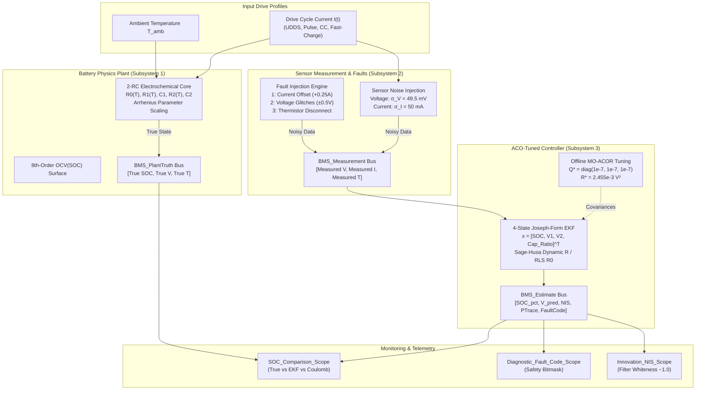
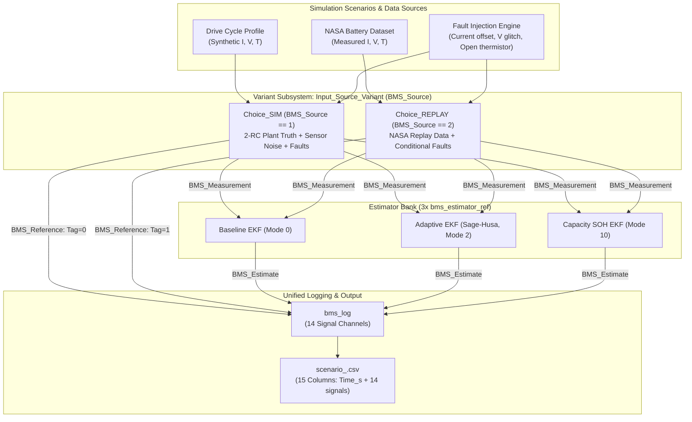
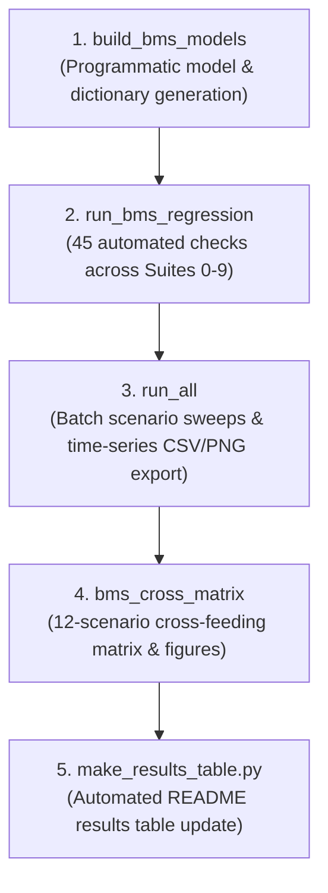

# 🏛️ BMS Architecture Overview

The **Thermal-Adaptive 2-RC MO-ACO-EKF System** is architected for model-based design, automotive-style workflows, providing mathematical equivalence across Python simulation, Simulink SIL simulation, and ANSI C microcontroller firmware.

---

## 🧩 High-Level System Architecture

---

## 📐 Signal Bus Definitions (`bms_data.sldd`)

All inter-subsystem communications flow over strongly-typed Simulink Bus Objects:

| Bus Name | Elements | Physical Units | Description |
| :--- | :--- | :---: | :--- |
| **`BMS_PlantTruth`** | `SOC_pct`, `Voltage_V`, `Temperature_K` | `[%]`, `[V]`, `[K]` | Ground-truth physical cell internal states |
| **`BMS_Measurement`** | `Voltage_V`, `Current_A`, `Temperature_K` | `[V]`, `[A]`, `[K]` | Hardware sensor readings corrupted by noise & faults |
| **`BMS_Estimate`** | `SOC_pct`, `Voltage_V`, `Innovation_V`, `PTrace`, `NIS`, `FaultCode`, `R0_Ohm`, `SOC_Coulomb_pct`, `R_cov_V2`, `CapacityRatio` | Various | Complete telemetry and diagnostic output from estimator |
| **`BMS_Reference`** | `SOC_pct`, `Source_Tag` | `[%]`, `[-]` | Reference cell SOC and source discriminator ($0.0 = \text{SIM}, 1.0 = \text{REPLAY}$) |

---

## 📦 Referenced Estimator Architecture (`bms_estimator_ref.slx`)

To eliminate code duplication, enforce modularity, and support multi-instance execution, the core estimation logic is encapsulated within a single reusable referenced model: [`bms_estimator_ref.slx`](../simulink_matlab/bms_estimator_ref.slx).

- **Execution Characteristics:** Discrete fixed-step ($T_s = 1.0\text{ s}$), multi-instance enabled (`TotalNumberRefModelInstancesAllowed = 'Multi'`).
- **Interfaces:** Strictly bus-typed. Accepts [`BMS_Measurement`](#bms_measurement) as input and emits [`BMS_Estimate`](#bms_estimate) as output.
- **Coder-Constant Parameterization:** The model block accepts an operating mode parameter (`bms_est_mode`), configuring the internal estimation algorithm without code branching or separate model files:
  - `Mode = 0`: Baseline Joseph-form Extended Kalman Filter with fixed tuned covariances ($Q^*, R^*$).
  - `Mode = 2`: Adaptive EKF (Sage-Husa) with dynamic measurement noise covariance adaptation and recursive least squares ($R_0$) estimation.
  - `Mode = 10`: SOH Capacity EKF with dual-state estimation tracking fading cell capacity over degradation cycles.
- **Model Sharing:** Reused across all top-level models—[`advanced_bms_aco_ekf.slx`](../simulink_matlab/advanced_bms_aco_ekf.slx) (1 instance), [`sota_bms_aco_ekf.slx`](../simulink_matlab/sota_bms_aco_ekf.slx) (3 parallel instances), and [`bms_unified.slx`](../simulink_matlab/bms_unified.slx) (3 parallel instances).

---

## 🔄 Unified System Model (`bms_unified.slx`)

[`bms_unified.slx`](../simulink_matlab/bms_unified.slx) replaces separate synthetic and replay models by integrating synthetic simulation and real measured NASA data replay into a single, cohesive Simulink architecture.

### 1. Variant Source Selection (`BMS_Source`)
The model uses a Simulink Variant Subsystem (`Input_Source_Variant`) configured with parameter-based variant control:
- **`BMS_Source == 1` (`Choice_SIM`)**: Executes the 2-RC equivalent circuit physical plant (`bms_plant_step`) corrupted by Gaussian sensor noise and fault injection. Emits `BMS_PlantTruth` and `BMS_Measurement`.
- **`BMS_Source == 2` (`Choice_REPLAY`)**: Feeds measured voltage, current, and temperature directly from NASA lithium-ion experimental datasets (cells B0005, B0006, B0007, B0018). Emits `BMS_Measurement` and optionally applies sensor faults if `BMS_InjectFaultsOnReplay == 1`.

### 2. Reference & Source Discrimination (`BMS_Reference`)
To enable automated regression testing and disambiguation, the source subsystem outputs a `BMS_Reference` bus containing:
- `SOC_pct`: Reference State of Charge ($0 \dots 100\,\%$). In SIM mode, this is true electrochemical plant SOC; in REPLAY mode, this is the coulomb-counter reference derived from NASA experimental discharge data.
- `Source_Tag`: Numeric tag ($0.0$ for SIM, $1.0$ for REPLAY). Regression Suite 8 tests verify that this tag is strictly non-vacuous.

### 3. Unified Telemetry Logging (`bms_log`)
All estimation and reference signals are bundled into a 14-signal `bms_log` bus:
1. `Reference SOC (%)` (`BS_Reference/SOC_pct`)
2. `EKF Baseline SOC (%)` (`BS_Baseline/SOC_pct`)
3. `Adaptive EKF SOC (%)` (`BS_Adaptive/SOC_pct`)
4. `Coulomb Counting SOC (%)` (`BS_Baseline/SOC_Coulomb_pct`)
5. `Measured Voltage (V)` (`BS_Measured/Voltage_V`)
6. `Adaptive Predicted Voltage (V)` (`BS_Adaptive/Voltage_V`)
7. `Innovation (V)` (`BS_Adaptive/Innovation_V`)
8. `NIS (Normalized Innovation Squared)` (`BS_Adaptive/NIS`)
9. `Diagnostic Fault Code Bitmask` (`BS_Adaptive/FaultCode`)
10. `Identified Resistance R0 (Ohm)` (`BS_Adaptive/R0_Ohm`)
11. `Adapted Measurement Variance R (V^2)` (`BS_Adaptive/R_cov_V2`)
12. `Capacity EKF SOC (%)` (`BS_Capacity/SOC_pct`)
13. `Estimated Capacity Ratio (SOH)` (`BS_Capacity/CapacityRatio`)
14. `Source Tag` (`BS_Reference/Source_Tag`)

When processed and exported by [`run_all.m`](../simulink_matlab/run_all.m), `Time_s` is prepended as column 1 to create standard 15-column scenario CSV archives in `results/scenario_<name>.csv`.

---

## 🔬 Cross-Feeding Performance Evaluation (`bms_cross_matrix.m`)

To rigorously benchmark estimator resilience across both known physics and physical experimental data, [`bms_cross_matrix.m`](../simulink_matlab/bms_cross_matrix.m) executes a cross-feeding test matrix evaluating all three estimator variants:
- **Baseline EKF (Mode 0):** Conventional Joseph-form EKF with static ACO-tuned covariances.
- **Adaptive EKF (Sage-Husa, Mode 2):** Dynamic measurement noise covariance ($R_k$) adaptation via Sage-Husa.
- **Capacity SOH EKF (Mode 10):** Dual-state joint SOC and capacity-ratio tracking.

### Evaluated Scenario Regimes:
1. **Simulated Plant Truth (`BMS_Source == 1`):** Nominal UDDS, dynamic pulses, sensor faults (current offset, voltage spikes, thermistor disconnect), and a full 40-run Monte Carlo ensemble ($\pm 20\%$ initial offset and parameter dispersion).
2. **NASA Laboratory Replay (`BMS_Source == 2`):** Fresh cells (B0005, B0007), heavily aged cells (120 cycles), and fault-injected replay via `BMS_InjectFaultsOnReplay = 1`.

### Metrics Tracked per Cell:
- **`MAE (%)` & `RMSE (%)`:** Steady-state tracking accuracy excluding the initial 120 s convergence window.
- **`P95 (%)` & `Max Error (%)`:** Bounded worst-case error under dynamic excitation and sensor noise.
- **`Time to <= 1% (stay 60s)` (`t_enter_1pct_s`):** Measured time (s) from $t=0$ until the absolute error first enters $|err| \le 1.0\%$ and remains $\le 1.0\%$ for at least 60 consecutive seconds. Reported as `NaN` if never maintained (no fallback).
- **`Post-120s Err > 1%` (`frac_err_gt_1pct`):** Fraction of samples strictly after the 120 s window ($t > 120\text{ s}$) where absolute error exceeds $1.0\%$.
- **`Spike Flag Rate` (`spike_flag_rate`):** Fraction of periodic voltage spike occurrences (spikes occur every 25 samples between $t = 899\text{ s}$ and $1199\text{ s}$, 13 spikes total) flagged by the outlier gate.
- **`First Flag Delay` (`first_flag_delay_s`):** Delay in seconds from the first fault spike (or fault onset for step faults) to the first active diagnostic flag.

Outputs are saved to `results/cross_matrix.csv` and visualized in `results/fig_cross_matrix.png` and `figures/17_simulink_cross_matrix.png`.

---

## 🚀 Unified Single Entry Point Pipeline (`run_everything.m`)

[`run_everything.m`](../simulink_matlab/run_everything.m) provides a single automated entry point that executes the entire Model-Based Design lifecycle from scratch:

- **Fail-Fast CI Contract:** Throws an explicit error and exits with a non-zero exit code if any model build, regression assertion, or export step fails.
- **Dual Execution Modes:**
  - `run_everything('quick')`: Runs rapid verification pipeline (~100 seconds).
  - `run_everything('full')` or `run_everything`: Executes full scenario sweeps, 40-run Monte Carlo, and full 12-scenario cross-feeding matrix.

---

## 🔒 3-Subsystem Layout Rationale

1. **`Battery_Physics_Plant`**: Isolates physical chemical and thermal equations from control logic.
2. **`Sensor_Measurement`**: Emulates automotive wiring harnesses, ADC quantization, and failure modes without modifying plant physics.
3. **`ACO_EKF_Controller`**: Blind to internal ground-truth; receives only sensor measurements, ensuring strict Software-in-the-Loop (SIL) fidelity.
