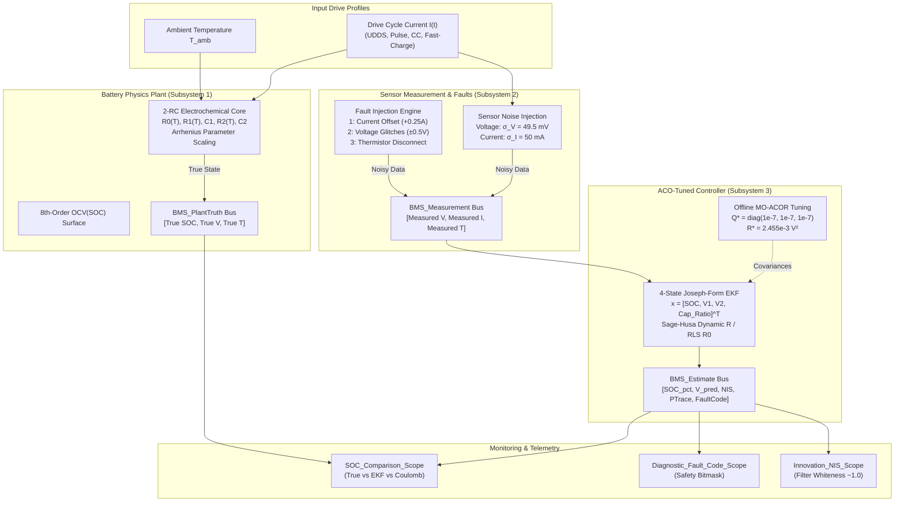

# 🏛️ BMS Architecture Overview

The **Thermal-Adaptive 2-RC MO-ACO-EKF System** is architected for automotive Model-Based Design (MBD), providing mathematical equivalence across Python simulation, Simulink SIL simulation, and ANSI C microcontroller firmware.

---

## 🧩 High-Level System Architecture

---

## 📐 Signal Bus Definitions (`bms_data.sldd`)

All inter-subsystem communications flow over strongly-typed Simulink Bus Objects:

| Bus Name | Elements | Physical Units | Description |
| :--- | :--- | :---: | :--- |
| **`BMS_PlantTruth`** | `SOC_pct`, `Voltage_V`, `Temperature_K` | `[%]`, `[V]`, `[K]` | Ground-truth physical cell internal states |
| **`BMS_Measurement`** | `Voltage_V`, `Current_A`, `Temperature_K` | `[V]`, `[A]`, `[K]` | Hardware sensor readings corrupted by noise & faults |
| **`BMS_Estimate`** | `SOC_pct`, `Voltage_V`, `Innovation_V`, `PTrace`, `NIS`, `FaultCode`, `R0_Ohm`, `SOC_Coulomb_pct`, `R_cov_V2`, `CapacityRatio` | Various | Complete telemetry and diagnostic output from estimator |

---

## 🔒 3-Subsystem Layout Rationale

1. **`Battery_Physics_Plant`**: Isolates physical chemical and thermal equations from control logic.
2. **`Sensor_Measurement`**: Emulates automotive wiring harnesses, ADC quantization, and failure modes without modifying plant physics.
3. **`ACO_EKF_Controller`**: Blind to internal ground-truth; receives only sensor measurements, ensuring strict Software-in-the-Loop (SIL) fidelity.
