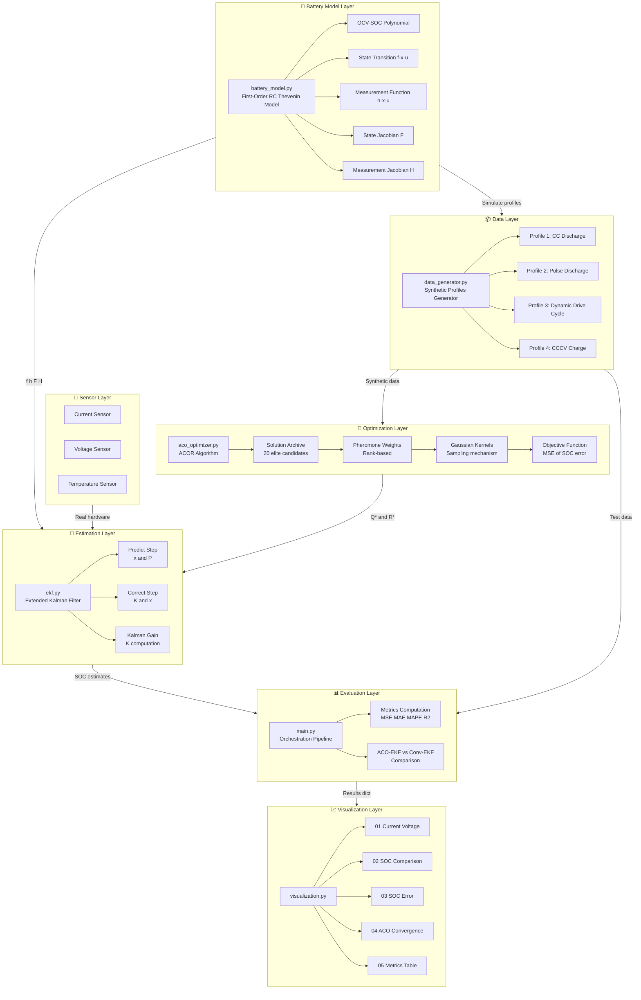
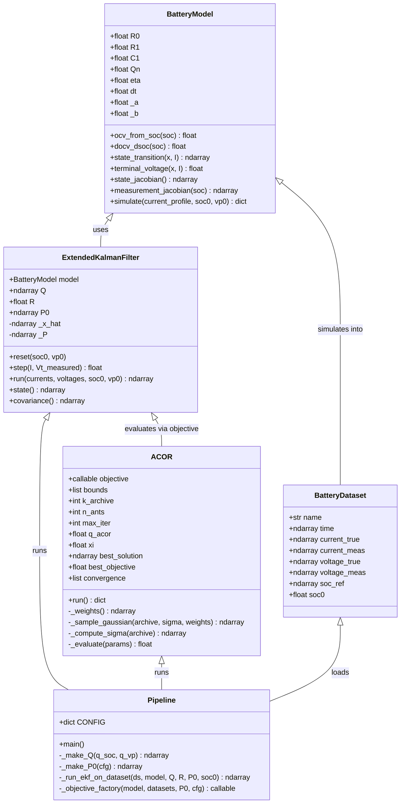
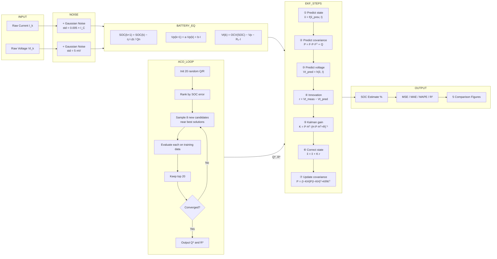
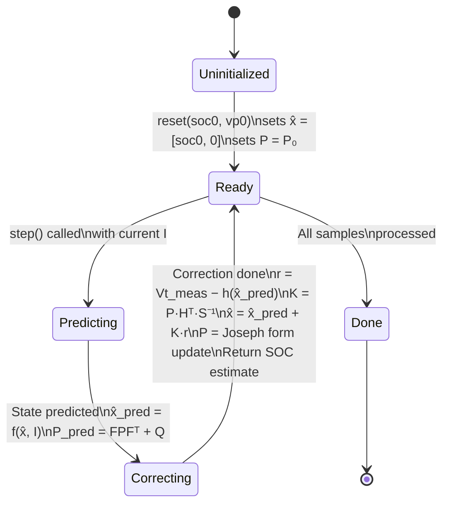
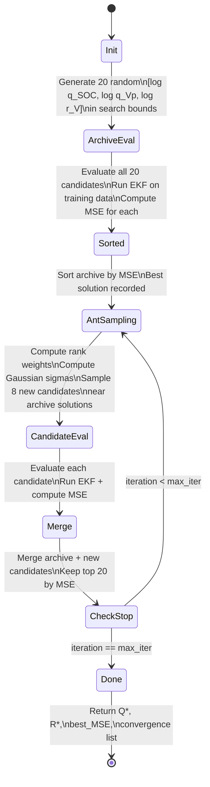
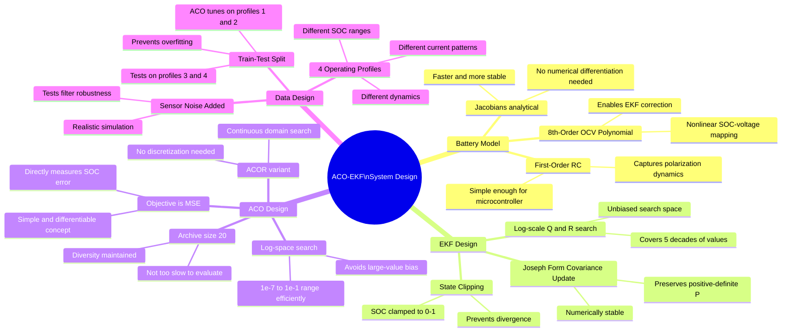
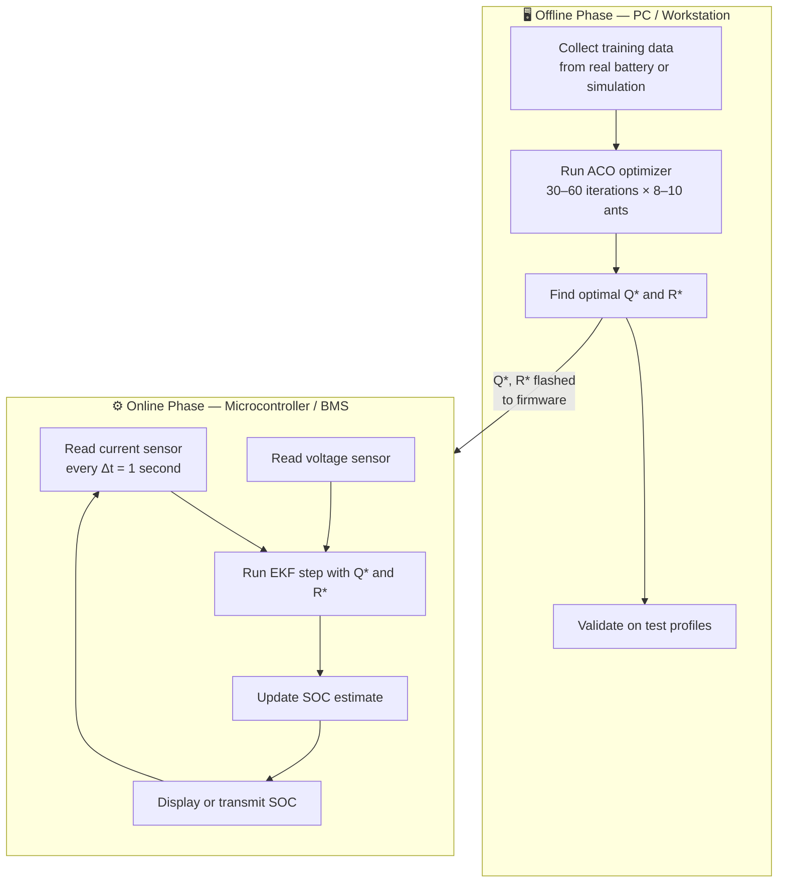
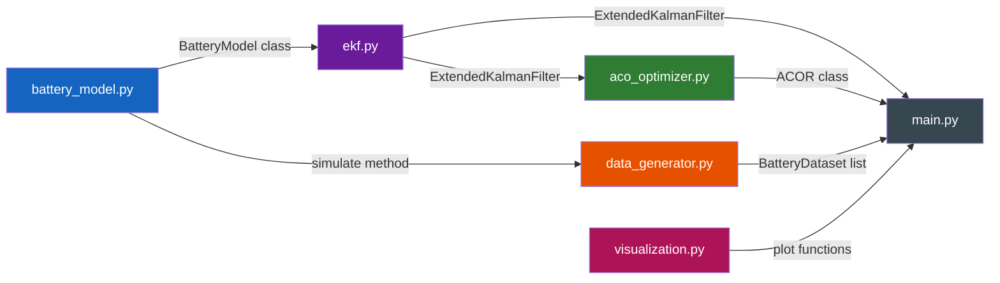
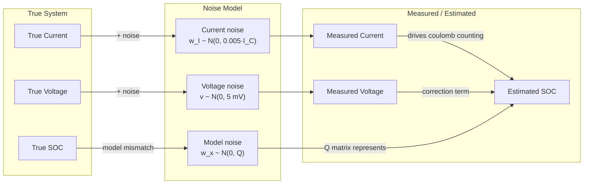

# System Design — ACO-EKF Battery SOC Estimation

---

## 1. High-Level System Architecture

---

## 2. Component Architecture

---

## 3. Data Flow Diagram

---

## 4. EKF Internal State Machine

---

## 5. ACO Optimization State Machine

---

## 6. Module Interface Contracts

### `battery_model.py`

| Method | Input | Output | Purpose |
|--------|-------|--------|---------|
| `ocv_from_soc(soc)` | `float [0,1]` | `float [V]` | OCV polynomial lookup |
| `docv_dsoc(soc)` | `float [0,1]` | `float [V]` | Derivative for Jacobian H |
| `state_transition(x, I)` | `x: (2,), I: float` | `(2,)` | Compute x(k+1) |
| `terminal_voltage(x, I)` | `x: (2,), I: float` | `float [V]` | Compute Vt |
| `state_jacobian()` | — | `(2,2)` | Constant F matrix |
| `measurement_jacobian(soc)` | `float` | `(1,2)` | H = [dOCV/dSOC, -1] |
| `simulate(I_profile, soc0)` | `(N,), float` | `dict` | Batch simulation |

### `ekf.py`

| Method | Input | Output | Purpose |
|--------|-------|--------|---------|
| `reset(soc0, vp0)` | `float, float` | — | Initialize filter state |
| `step(I, Vt_meas)` | `float, float` | `float [SOC]` | One EKF recursion |
| `run(currents, voltages, soc0)` | `(N,), (N,), float` | `(N,) [SOC]` | Batch processing |

### `aco_optimizer.py`

| Method | Input | Output | Purpose |
|--------|-------|--------|---------|
| `run()` | — | `dict` | Full ACOR optimization |
| `_weights()` | — | `(k,)` | Rank-based pheromone weights |
| `_compute_sigma(archive)` | `(k,3)` | `(k,3)` | Gaussian kernel widths |
| `_sample_gaussian(archive, sigma, w)` | `(k,3),(k,3),(k,)` | `(3,)` | Draw one candidate |
| `_evaluate(params)` | `[q_SOC, q_Vp, r_V]` | `float` | Run objective function |

---

## 7. Key Design Decisions

---

## 8. Deployment View

### Resource Requirements

| Phase | Platform | Memory | Computation |
|-------|----------|--------|-------------|
| ACO Tuning | PC / workstation | ~50 MB RAM | 30–600 sec (depends on iterations) |
| EKF Real-Time | Microcontroller | < 2 KB RAM | < 1 ms per sample at 1 Hz |

---

## 9. File Dependency Map

---

## 10. Error & Noise Model

---

## Summary Table

| Layer | File | Technology | Key Algorithm |
|-------|------|-----------|---------------|
| **Battery Model** | `battery_model.py` | NumPy | First-order RC, OCV polynomial, Jacobians |
| **Data** | `data_generator.py` | NumPy | Profile simulation + Gaussian noise |
| **Estimation** | `ekf.py` | NumPy | EKF with Joseph-form P update |
| **Optimization** | `aco_optimizer.py` | NumPy | ACOR: rank-weighted Gaussian sampling |
| **Pipeline** | `main.py` | Python | Train/test split, CONFIG dict |
| **Visualization** | `visualization.py` | Matplotlib | 5 publication figures |
| **Docs** | `README.md` | Markdown | Usage guide |
